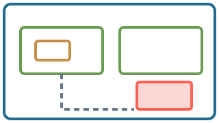
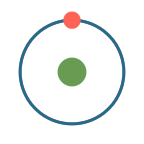
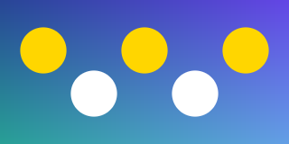

<!-- A guided tour of every feature of the Markdown dialect. Each slide pairs a listing with the result it produces. -->

::: styles
callout: color=ORANGE font_size=30
heading: color=BLUE_E
:::

::: slide {#guide width=36}
# Zoomdeck {x=-17.35 y=9.2}

A tour of the Markdown dialect and the player: each slide pairs a listing with its result. Press → to follow the tree in pre-order, or pick a slide from the outline (O). {x=-17.35 y=8.2 width=35 font_size=28}

[[include: #tree x=-16.25 y=5.2 width=6 skip_return=true]]
[[include: #prose x=-9.75 y=5.2 width=6 skip_return=true]]
[[include: #math x=-3.25 y=5.2 width=6 skip_return=true]]
[[include: #images x=3.25 y=5.2 width=6 skip_return=true]]
[[include: #shapes x=9.75 y=5.2 width=6 skip_return=true]]
[[include: #more-shapes x=16.25 y=5.2 width=6]]
[[include: #sketch x=-16.25 y=1.3 width=6 skip_return=true]]
[[include: #icons x=-9.75 y=1.3 width=6 skip_return=true]]
[[include: #enclosures x=-3.25 y=1.3 width=6 skip_return=true]]
[[include: #layout x=3.25 y=1.3 width=6 skip_return=true]]
[[include: #anchors x=9.75 y=1.3 width=6 skip_return=true]]
[[include: #styles x=16.25 y=1.3 width=6]]
[[include: #groups x=-16.25 y=-2.6 width=6 skip_return=true]]
[[include: #fragments x=-9.75 y=-2.6 width=6 skip_return=true]]
[[include: #focus x=-3.25 y=-2.6 width=6 skip_return=true]]
[[include: #children x=3.25 y=-2.6 width=6 skip_return=true]]
[[include: #imports x=9.75 y=-2.6 width=6 skip_return=true]]
[[include: #tables x=16.25 y=-2.6 width=6]]
[[include: #code-slides x=-13 y=-6.5 width=6 skip_return=true]]
[[include: #listings x=-6.5 y=-6.5 width=6 skip_return=true]]
[[include: #animations x=0 y=-6.5 width=6 skip_return=true]]
[[include: #media x=6.5 y=-6.5 width=6 skip_return=true]]
[[include: #player x=13 y=-6.5 width=6]]
:::

::: slide {#tree width=20}
## Slides form a tree

Every slide is a `::: slide {#id}` container with its own logical canvas: 16 × 9 by default, or the size given by `width` and `height`. An `[[include: #id ...]]` places a child viewport in the parent's coordinates; the camera zooms into each child in turn and back out to its parent. {x=-9.35 width=19 font_size=22}

```markdown {#tree-source x=-9.35 y=1.6 width=9.5}
::: slide {#tree width=20}
## Slides form a tree
[[include: #branch x=4.5 y=-2 width=9 angle=0.08]]
:::

::: slide {#branch}
## A branch
[[include: #leaf x=3 y=-1.5 width=6 angle=-0.15]]
:::

::: slide {#leaf width=8}
## A leaf: an 8 × 4.5 canvas
:::
```

[[include: #branch x=4.5 y=-2 width=9 angle=0.08]]
:::

::: slide {#branch}
## A branch

Includes without `step` are visited in source order after the parent's own steps. `width` or `height` sets the viewport size (the other follows the child's aspect ratio) and `angle` rotates it, in radians. {x=-7.35 width=14.7 font_size=22}

[[include: #leaf x=3 y=-1.5 width=6 angle=-0.15]]
:::

::: slide {#leaf width=8}
## A leaf: an 8 × 4.5 canvas {font_size=26}

Returning zooms back out to the parent. {x=-3.35 y=0.2 width=7 font_size=20}
:::

::: slide {#prose width=20}
## Prose and inline styling

```markdown {#prose-source x=-9.35 y=3.7 width=9.5}
Paragraphs wrap to `width`. Use **bold**, *italic*,
`inline code` and math $e^{i\pi}+1=0$.

[Colored spans]{color=ORANGE} take palette names,
[CSS colors]{style="color:#15803D"} or hex values
and [nest **emphasis** and $\sqrt{2}$]{color=GOLD_E}.

First line.\\
Second line after an explicit break.

- Bullet items are prose with a marker
  - Nested items indent
    1. Numbered lists nest too
- Headings set size only: `#` to `######`

### A level-3 heading

Links like [this one](https://vite.dev) are clickable.

<!-- HTML comments are discarded. -->
```

Paragraphs wrap to `width`. Use **bold**, *italic*, `inline code` and math $e^{i\pi}+1=0$. {x=0.6 width=9}

[Colored spans]{color=ORANGE} take palette names, [CSS colors]{style="color:#15803D"} or hex values and [nest **emphasis** and $\sqrt{2}$]{color=GOLD_E}. {x=0.6 width=9}

First line.\\
Second line after an explicit break. {x=0.6 width=9}

- Bullet items are prose with a marker {x=0.6 width=9}
  - Nested items indent {x=0.6 width=8.4}
    1. Numbered lists nest too {x=0.6 width=7.8}
- Headings set size only: `#` to `######` {x=0.6 width=9}

### A level-3 heading {x=0.6}

Links like [this one](https://vite.dev) are clickable. {x=0.6 width=9}

Blank lines separate elements. Attributes in braces at the end of a block apply to that block: `{#id x=.. y=.. width=.. font_size=.. color=.. step=..}`. {x=-9.35 y=-4.1 width=19 font_size=22}
:::

::: slide {#math width=20}
## Mathematics

```markdown {#math-source x=-9.35 y=3.7 width=9.5}
Inline math shares the baseline: $\int_0^1 x^2\,dx = \tfrac13$.

$$
\sum_{k=0}^{n} \binom{n}{k} = 2^n
$$

::: {.element #pythagoras x=0.6 y=-0.4 font_size=34}
$$ \textcolor{Orange}{a}^2 + {\color{Cerulean} b^2} = c^2 $$
:::

Macros from deck.json: $\N \subset \R$.
```

Inline math shares the baseline: $\int_0^1 x^2\,dx = \tfrac13$. {x=0.6 width=9}

::: {.element x=0.6 width=9}
$$
\sum_{k=0}^{n} \binom{n}{k} = 2^n
$$
:::

::: {.element #pythagoras x=0.6 y=-0.4 font_size=34}
$$ \textcolor{Orange}{a}^2 + {\color{Cerulean} b^2} = c^2 $$
:::

Macros from deck.json: $\N \subset \R$. {x=0.6 y=-1.8 width=9}

Single dollars give inline math, `$$` lines a display formula; a `::: {.element ...}` container positions, sizes or animates a formula. LaTeX runs through MathJax; `\textcolor` and `\color` accept dvipsnames and CSS colors. {x=-9.35 y=-3.4 width=19 font_size=22}
:::

::: slide {#images width=20}
## Images and animated images

```markdown {#images-source x=-9.35 y=3.7 width=19}
{#svg x=-6.5 y=-2.6 width=4}

{#once x=0 y=-2.6 width=3 play=once step=1}

{#loop right-of:#once buff=1.5 width=3 play=loop step=2 hide=3}
```

Images are centered on `x`, `y` and sized by `width`. SVG files keep nested transforms and styles; raster files may be PNG, JPEG, GIF or WebP, and multi-frame APNG or GIF files take `play=once` or `play=loop`. {x=-9.35 y=0.6 width=19 font_size=22}

{#svg x=-6.5 y=-2.6 width=4}

{#once x=0 y=-2.6 width=3 play=once step=1}

{#loop right-of:#once buff=1.5 width=3 play=loop step=2 hide=3}
:::

::: slide {#shapes width=20}
## Shapes and connections

```markdown {#shapes-source x=-9.35 y=3.7 width=19}
[[rectangle: #box x=-6 y=-2.4 width=3.4 height=1.8 corner_radius=0.3 color=BLUE_E fill_opacity=0.15]]
[[circle: #disk right-of:#box buff=2.5 radius=0.9 color=GREEN_E href=https://puppis.github.io/zoomdeck/]]
[[polyline: #zigzag points="(3,-4) (5,-2) (7,-3.6) (9,-1.8)" color=ORANGE]]
[[arrow: #box -> #disk, #edge, label="**labelled** $\to$"]]
[[line: #disk -> (-1.2,-5), #drop, color=GRAY]]
```

Shapes need an `#id`; `color`, `stroke_width`, `fill_color` and `fill_opacity` style them and every positioning attribute places them. Arrows and lines join element IDs, attached at the facing edges, or literal `(x,y)` points; labels take inline styling and math. `href=` makes any element a clickable link (try the circle). {x=-9.35 y=0.7 width=19 font_size=22}

[[rectangle: #box x=-6 y=-2.4 width=3.4 height=1.8 corner_radius=0.3 color=BLUE_E fill_opacity=0.15]]
[[circle: #disk right-of:#box buff=2.5 radius=0.9 color=GREEN_E href=https://puppis.github.io/zoomdeck/]]
[[polyline: #zigzag points="(3,-4) (5,-2) (7,-3.6) (9,-1.8)" color=ORANGE]]
[[arrow: #box -> #disk, #edge, label="**labelled** $\to$"]]
[[line: #disk -> (-1.2,-5), #drop, color=GRAY]]
:::

::: slide {#more-shapes width=20}
## More shapes, braces and boxes

```markdown {#more-shapes-source x=-9.35 y=3.7 width=19}
[[dot: #p x=-8.5 y=-2.4 color=GOLD_E]]
[[ellipse: #e x=-5.5 y=-2.4 width=3.4 height=1.6 color=TEAL_E fill_opacity=0.2]]
[[polygon: #tri points="(-2.5,-3.2) (-0.5,-1.2) (0.5,-3.2)" color=ORANGE fill_opacity=0.3]]
[[arc: #a x=3.5 y=-2.8 radius=1.4 angle=2.4 color=RED opacity=0.4]]
[[brace: #e, #be, side=bottom, label="an ellipse"]]
[[box: #tri, #bx, buff=0.2, corner_radius=0.1, color=GREEN_E, step=1]]
```

Point-defined shapes (`polygon`, `polyline`, `arc`) keep their coordinates unless positioned. A `brace` or `box` is attached to an element after layout and has its own `step`; `opacity` applies to any element and survives its fades. {x=-9.35 y=0.6 width=19 font_size=22}

[[dot: #p x=-8.5 y=-2.4 color=GOLD_E]]
[[ellipse: #e x=-5.5 y=-2.4 width=3.4 height=1.6 color=TEAL_E fill_opacity=0.2]]
[[polygon: #tri points="(-2.5,-3.2) (-0.5,-1.2) (0.5,-3.2)" color=ORANGE fill_opacity=0.3]]
[[arc: #a x=3.5 y=-2.8 radius=1.4 angle=2.4 color=RED opacity=0.4]]
[[brace: #e, #be, side=bottom, label="an ellipse"]]
[[box: #tri, #bx, buff=0.2, corner_radius=0.1, color=GREEN_E, step=1]]
:::

::: slide {#sketch width=20}
## Hand-drawn shapes

```markdown {#sketch-source x=-9.35 y=3.7 width=19}
[[rectangle: #hr x=-6.5 y=-3 width=3.4 height=1.8 color=BLUE_E fill_opacity=0.5 sketch=true]]
[[circle: #hc right-of:#hr buff=1.5 radius=0.9 color=GREEN_E fill_opacity=0.6 fill_style=cross-hatch sketch=true]]
[[polygon: #hp points="(0.5,-3.9) (2,-2) (3.5,-3.9)" color=ORANGE fill_opacity=1 fill_style=solid roughness=2 sketch=true]]
[[arrow: #hr -> #hc, #ha, sketch=true]]
[[brace: #hp, #hb, side=bottom, label="by hand", sketch=true]]
```

`sketch=true` draws a shape, icon, connection or attachment as if by hand: a wobbly outline and a hatched or solid fill (`fill_style`), tuned by `roughness`, `bowing`, `hachure_angle`, `hachure_gap`, `fill_weight` and `seed`. A `shape: sketch=true` style sketches a whole deck. {x=-9.35 y=0.6 width=19 font_size=22}

[[rectangle: #hr x=-6.5 y=-3 width=3.4 height=1.8 color=BLUE_E fill_opacity=0.5 sketch=true]]
[[circle: #hc right-of:#hr buff=1.5 radius=0.9 color=GREEN_E fill_opacity=0.6 fill_style=cross-hatch sketch=true]]
[[polygon: #hp points="(0.5,-3.9) (2,-2) (3.5,-3.9)" color=ORANGE fill_opacity=1 fill_style=solid roughness=2 sketch=true]]
[[arrow: #hr -> #hc, #ha, sketch=true]]
[[brace: #hp, #hb, side=bottom, label="by hand", sketch=true]]
:::

::: slide {#icons width=20}
## Icons for diagrams

```markdown {#icons-source x=-9.35 y=3.7 width=19}
[[icon: user #alice x=-7 y=-2.4 size=1.4 color=BLUE_E label="Alice"]]
[[icon: server #api right-of:#alice buff=3 size=1.4 color=GREEN_E fill_opacity=0.25 label="api" label_side=above]]
[[icon: database #db right-of:#api buff=3 size=1.4 color=GOLD_E fill_opacity=0.3 label="orders"]]
[[icon: cloud #cdn right-of:#db buff=2 size=1.4 color=TEAL_E label="cdn" sketch=true]]
[[arrow: #alice -> #api, #req, label="HTTPS"]]
[[arrow: #api -> #db, #sql, label="SQL", step=1]]
```

`[[icon: name #id ...]]` draws one of 39 symbols built from geometry: people and machines (`user`, `server`, `database`, `cloud`, ...), files (`document`, `folder`, `message`, ...), marks (`check`, `question`, `warning`, `pin`, ...) and actions (`download`, `search`, `trash`, `gear`, ...). `size` sets its height, `color`, `stroke_width` and `fill_opacity` style it, `label` and `label_side` caption it. Icons are positioned, connected, enclosed, animated and sketched like shapes. {x=-9.35 y=0.6 width=19 font_size=22}

[[icon: user #alice x=-7 y=-2.4 size=1.4 color=BLUE_E label="Alice"]]
[[icon: server #api right-of:#alice buff=3 size=1.4 color=GREEN_E fill_opacity=0.25 label="api" label_side=above]]
[[icon: database #db right-of:#api buff=3 size=1.4 color=GOLD_E fill_opacity=0.3 label="orders"]]
[[icon: cloud #cdn right-of:#db buff=2 size=1.4 color=TEAL_E label="cdn" sketch=true]]
[[arrow: #alice -> #api, #req, label="HTTPS"]]
[[arrow: #api -> #db, #sql, label="SQL", step=1]]
:::

::: slide {#enclosures width=20}
## Boxes and blobs around several elements

```markdown {#enclosures-source x=-9.35 y=3.7 width=19}
[[icon: server #web x=-6.5 y=-1.9 size=1.1 color=GREEN_E label="web" label_side=right]]
[[icon: server #worker x=-6.5 y=-3.9 size=1.1 color=GREEN_E label="worker" label_side=right]]
[[icon: database #store x=-1.5 y=-2.9 size=1.1 color=GOLD_E label="store" label_side=right]]
[[box: #web #worker, #tier, buff=0.3, corner_radius=0.2, color=GRAY, step=1]]
[[blob: #web #worker #store, #backend, buff=0.45, smoothness=0.7, color=GREEN_E, fill_opacity=0.08, step=2, hide=3]]
[[blob: #store, #attention, buff=0.3, color=RED, sketch=true, step=3, tremble=3]]
```

[[icon: server #web x=-6.5 y=-1.9 size=1.1 color=GREEN_E label="web" label_side=right]]
[[icon: server #worker x=-6.5 y=-3.9 size=1.1 color=GREEN_E label="worker" label_side=right]]
[[icon: database #store x=-1.5 y=-2.9 size=1.1 color=GOLD_E label="store" label_side=right]]
[[box: #web #worker, #tier, buff=0.3, corner_radius=0.2, color=GRAY, step=1]]
[[blob: #web #worker #store, #backend, buff=0.45, smoothness=0.7, color=GREEN_E, fill_opacity=0.08, step=2, hide=3]]
[[blob: #store, #attention, buff=0.3, color=RED, sketch=true, step=3, tremble=3]]

A `box` or `blob` lists the elements it surrounds before the first comma, then its own `#id`. The box grows their joint rectangle by `buff`; the blob is a smooth curve at distance `buff` from every member, and `smoothness` (0 to 1) decides how softly neighbours merge. `tremble=3` makes vector geometry vibrate from step 3 on (`N-M` for a range, `true` from its appearance), and pairs well with `sketch=true`. {x=2.6 y=-1.3 width=7.2 font_size=19}
:::

::: slide {#layout width=20}
## Positioning and relative layout

```markdown {#layout-source x=-9.35 y=3.7 width=9.5}
### A heading {#h x=0.6 y=1.6}

[Below it, left-aligned]{#p below:#h left-aligned:#h buff=0.3}

[A side note]{#note right-of:#p buff=0.5}

[Big]{#big x=0.6 y=-1.4 font_size=48 color=TEAL_E}
[shares the baseline]{x=2.3 baseline-aligned:#big}

[Centered on a point]{x=5 y=-3.2 anchor=center color=ORANGE}
[[dot: #mark x=5 y=-3.2 color=ORANGE]]
```

### A heading {#h x=0.6 y=1.6}

[Below it, left-aligned]{#p below:#h left-aligned:#h buff=0.3}

[A side note]{#note right-of:#p buff=0.5}

[Big]{#big x=0.6 y=-1.4 font_size=48 color=TEAL_E}

[shares the baseline]{x=2.3 baseline-aligned:#big}

[Centered on a point]{x=5 y=-3.2 anchor=center color=ORANGE}

[[dot: #mark x=5 y=-3.2 color=ORANGE]]

For text, `x` is the left edge and `y` the first baseline; images, shapes and child viewports use their center, unless `anchor=` says otherwise. `below`, `above`, `left-of`, `right-of` (with `buff`), the `*-aligned` references and `baseline-aligned` place an element against another; elements without coordinates flow downward from the top-left margin. {x=-9.35 y=-4.1 width=19 font_size=22}
:::

::: slide {#anchors width=20}
## Anchors, offsets and timing

```markdown {#anchors-source x=-9.35 y=3.7 width=19}
{#img x=-9.35 y=0.4 width=4 anchor=top-left}
[[dot: #corner x=-9.35 y=0.4 radius=0.1 color=RED]]
[Nudged with dx and dy]{#nudge below:#img left-aligned:#img dx=0.4 dy=-0.2}
[Ends at x = 9.35]{#rb x=9.35 y=-0.4 anchor=right-baseline color=ORANGE}
[Fades in over 1.5 s]{#slow x=-3.5 y=-0.4 step=1 run_time=1.5}
[Starts 0.5 s later]{#later below:#slow left-aligned:#slow step=1 lag=0.5 color=GREEN_E}
```

{#img x=-9.35 y=0.4 width=4 anchor=top-left}

[[dot: #corner x=-9.35 y=0.4 radius=0.1 color=RED]]

[Nudged with dx and dy]{#nudge below:#img left-aligned:#img dx=0.4 dy=-0.2}

[Ends at x = 9.35]{#rb x=9.35 y=-0.4 anchor=right-baseline color=ORANGE}

[Fades in over 1.5 s]{#slow x=-3.5 y=-0.4 step=1 run_time=1.5}

[Starts 0.5 s later]{#later below:#slow left-aligned:#slow step=1 lag=0.5 color=GREEN_E}

`anchor` names the point that `x`, `y` position: `center`, `top`, `bottom`, `left`, `right`, the four corners, and `left-baseline` or `right-baseline` for text (the red dot marks the image's anchor). `dx`/`dy` nudge any placement. `run_time` and `lag` time an element's own fades; elements sharing a step play in one click. {x=-9.35 y=-3.4 width=12 font_size=20}
:::

::: slide {#styles width=20}
## Anchor expressions and styles

```markdown {#styles-source x=-9.35 y=3.7 width=19}
[[rectangle: #ref x=-6 y=-2.2 width=3 height=1.6 color=GRAY]]
[My top-left at its bottom-right]{#tl at=top-left:#ref.bottom-right dx=0.2 color=GOLD_E}
[Centered on (5, -3.6)]{#cp at=center:(5,-3.6)}
[A footnote with the .footnote style from deck.json]{.footnote at=#ref.bottom-left anchor=top-left dy=-0.9}
[Styled by .callout from the styles block]{#co .callout at=#cp.top anchor=bottom dy=0.3}
```

```json {#styles-json x=-9.35 y=0.9 width=9}
"styles": { "footnote": { "font_size": 18, "color": "GRAY" } }
```

```markdown {#styles-block x=0.6 y=0.9 width=9}
::: styles
callout: color=ORANGE font_size=30
heading: color=BLUE_E
:::
```

[[rectangle: #ref x=-6 y=-2.2 width=3 height=1.6 color=GRAY]]

[My top-left at its bottom-right]{#tl at=top-left:#ref.bottom-right dx=0.2 color=GOLD_E}

[Centered on (5, -3.6)]{#cp at=center:(5,-3.6)}

[A footnote with the .footnote style from deck.json]{.footnote at=#ref.bottom-left anchor=top-left dy=-0.9}

[Styled by .callout from the styles block]{#co .callout at=#cp.top anchor=bottom dy=0.3}

`at=` puts one anchor of an element on an anchor of another element (`#id.anchor`, center by default) or on a point; `anchor:` before the target, or `anchor=`, chooses the element's own point. Named styles come from `styles` in deck.json or a `::: styles` block; `.class` tokens apply them, and roles such as `heading`, `body`, `code` or `shape` apply automatically (every heading of this deck is blue because of the block above). {x=-9.35 y=-4.7 width=19 font_size=19}
:::

::: slide {#groups width=20}
## Groups

```markdown {#groups-source x=-9.35 y=3.7 width=9.5}
::: {.group #automaton x=2 y=-0.5 step=1}
[[circle: #q0 x=0 y=0 radius=0.6 color=BLUE_E]]
[$q_0$]{at=#q0.center anchor=center}
[[circle: #q1 x=3 y=0 radius=0.6 color=BLUE_E]]
[$q_1$]{at=#q1.center anchor=center}
[[arrow: #q0 -> #q1, #t, label="$a$"]]
:::

[[dot: #origin x=2 y=-0.5 color=RED]]
[[box: #automaton, #gbox, buff=0.3, color=GREEN_E, step=2]]
```

::: {.group #automaton x=2 y=-0.5 step=1}
[[circle: #q0 x=0 y=0 radius=0.6 color=BLUE_E]]
[$q_0$]{at=#q0.center anchor=center}
[[circle: #q1 x=3 y=0 radius=0.6 color=BLUE_E]]
[$q_1$]{at=#q1.center anchor=center}
[[arrow: #q0 -> #q1, #t, label="$a$"]]
:::

[[dot: #origin x=2 y=-0.5 color=RED]]

[[box: #automaton, #gbox, buff=0.3, color=GREEN_E, step=2]]

A `::: {.group #id}` container lays out its members in their own coordinates and behaves as one element: `x`, `y` place its `origin` (the red dot) unless `anchor=` picks a bounding-box point, relative constraints and `at=` work on it, it fades in and out as a whole, and braces, boxes, blobs and arrows attach to it. Members only reference other members. {x=-9.35 y=-3.3 width=19 font_size=20}
:::

::: slide {#fragments width=20}
## Fragments and click steps

```markdown {#fragments-source x=-9.35 y=3.7 width=9.5}
[Visible on entry, hidden at step 3]{#hint x=0.6 y=1.7 hide=3}

[Appears at step 1]{#one x=0.6 y=0.9 step=1 color=GREEN_E}

[Step 2 reveals this, then advances by itself]{#two x=0.6 y=0.1 step=2 color=GOLD_E}
[[next: step=2]]

[Step 3 shows this and hides the hint]{#three x=0.6 y=-0.7 step=3}

[[show: #hint step=4]]
[[hide: #one step=4]]
[[skip_next: step=4]]

[Never shown: step 5 is skipped]{#five x=0.6 y=-1.5 step=5}

[Step 6 follows step 4 directly]{#six x=0.6 y=-2.3 step=6 color=RED}
```

[Visible on entry, hidden at step 3]{#hint x=0.6 y=1.7 hide=3}

[Appears at step 1]{#one x=0.6 y=0.9 step=1 color=GREEN_E}

[Step 2 reveals this, then advances by itself]{#two x=0.6 y=0.1 step=2 color=GOLD_E}

[[next: step=2]]

[Step 3 shows this and hides the hint]{#three x=0.6 y=-0.7 step=3}

[[show: #hint step=4]]
[[hide: #one step=4]]
[[skip_next: step=4]]

[Never shown: step 5 is skipped]{#five x=0.6 y=-1.5 step=5}

[Step 6 follows step 4 directly]{#six x=0.6 y=-2.3 step=6 color=RED}

`step=N` fades an element in and `hide=M` fades it out; `[[show]]` and `[[hide]]` repeat changes. All changes sharing a number play together, then the deck pauses. `[[next: step=N]]` advances automatically after N; `[[skip_next: step=N]]` drops the following event, be it a step, a child visit or the return to the parent. {x=-9.35 y=-3.7 width=19 font_size=22}
:::

::: slide {#focus width=20}
[[rectangle: #paper x=0 y=0 width=20 height=11.25 fill_color="#E2E8F0" fill_opacity=1 stroke_width=0 focus_only=true]]

## Decorations visible only in focus

```markdown {#focus-source x=-9.35 y=3.7 width=19}
[[rectangle: #paper x=0 y=0 width=20 height=11.25 fill_color="#E2E8F0" fill_opacity=1 stroke_width=0 focus_only=true]]

[This caption fades in with focus and out when the camera leaves]{#caption x=-9.35 y=0.6 width=19 focus_only=true color=TEAL_E}
```

[This caption fades in with focus and out when the camera leaves]{#caption x=-9.35 y=0.6 width=19 focus_only=true color=TEAL_E}

Look at this slide from its parent: the panel and the caption are gone while this ordinary text stays. Focus-only elements are static (no `step`, `hide` or `play`), are drawn behind the slide's content and still work as positioning anchors. {x=-9.35 y=-1.4 width=19 font_size=22}
:::

::: slide {#children width=20}
## Children, visit order and placeholders

```markdown {#children-source x=-9.35 y=3.7 width=9.5}
[[include: #visited-second x=4.7 y=-2.2 width=7 step=2 skip_return=true]]
[[include: #visited-first x=-4.7 y=-2.2 width=7 step=1 transition=cut]]

[Revealed at step 2, before the second child]{#between x=-9.35 y=0.6 step=2}

[[include: #missing x=7.3 y=2.3 width=4]]
```

[[include: #visited-second x=4.7 y=-2.2 width=7 step=2 skip_return=true]]
[[include: #visited-first x=-4.7 y=-2.2 width=7 step=1 transition=cut]]

[Revealed at step 2, before the second child]{#between x=-9.35 y=0.6 step=2}

[[include: #missing x=7.3 y=2.3 width=4]]

An include with `step` interleaves the child visit with the parent's fragments; without `step` it is visited in source order after the numbered steps. `skip_return=true` leaves a child straight for the next stop without zooming out first. `transition=cut` enters and leaves a slide without the camera animation, like a PDF page (`"presenter": {"transition": "cut"}` does it for the whole deck). An undefined slide (here `#missing`) is drawn as a red placeholder and skipped during playback. {x=-9.35 y=-4.9 width=19 font_size=22}
:::

::: slide {#visited-first}
## Visited first (step 1)

`subslide` is an alias of `include`. Every slide has exactly one parent; to show the same content twice, define it twice with different IDs. {x=-7.35 width=14.7 font_size=22}
:::

::: slide {#visited-second}
## Visited second (step 2)

Mark one slide or include with `start_here=true` to open playback there. While editing, `only_this=true` on a slide or include prepares only that subtree and turns everything else into red placeholders. {x=-7.35 width=14.7 font_size=22}
:::

::: slide {#imports width=20}
## Importing markup from files

```markdown {#imports-source x=-9.35 y=3.7 width=9.5}
<!-- slides.md -->
::: slide {#imports width=20}
## Importing markup from files
[[import: parts/footer.md]]
[[include: #appendix x=5 y=-2.6 width=8]]
:::

[[import: parts/appendix.md]]
```

```markdown {#imports-parts x=0.6 y=3.7 width=9}
<!-- parts/footer.md -->
[Imported from parts/footer.md]{#footer x=-9.35 y=-4.6 color=GRAY}

<!-- parts/appendix.md -->
::: slide {#appendix}
## Defined in parts/appendix.md

[A file imported between slides adds its slides
 and styles; include them like any other.]{...}
:::
```

[[import: parts/footer.md]]

[[include: #appendix x=5 y=-2.6 width=8]]

`[[import: path.md]]` splices a file into the document before parsing: between slides it adds slides and style blocks, inside a slide it adds elements and directives. Paths are relative to the importing file, a file may import others, and errors name the file and line. {x=-9.35 y=-0.9 width=10 font_size=22}
:::

[[import: parts/appendix.md]]

::: slide {#tables width=20}
## Tables and charts

````markdown {#tables-source x=-9.35 y=3.7 width=9.5}
::: {.element #sales x=5 y=1.3 rules=rows stripe_opacity=0.08}
| Region | 2023 | 2024 |
| :--- | ---: | ---: |
| North | 3.2 | **5.0** |
| South | 2.1 | $\pi$ |
:::

```chart {#bars x=5 y=-2.6 width=6 height=2.6 values=true}
Region, 2023, 2024
North, 3.2, 5.0
South, 2.1, 3.1
```
````

::: {.element #sales x=5 y=1.3 rules=rows stripe_opacity=0.08}
| Region | 2023 | 2024 |
| :--- | ---: | ---: |
| North | 3.2 | **5.0** |
| South | 2.1 | $\pi$ |
:::

```chart {#bars x=5 y=-2.6 width=6 height=2.6 values=true}
Region, 2023, 2024
North, 3.2, 5.0
South, 2.1, 3.1
```

A pipe table becomes a grid of styled cells; a `::: {.element ...}` container positions it and sets `rules` (all, rows, cols, outer, none), `border_color`, `stroke_width`, `header_color`/`header_opacity`, `stripe_opacity`, `fill_color`/`fill_opacity` and `padding`. A `chart` fence holds comma-separated rows, the first naming the series: `type=bar|line|pie`, `width`, `height`, `colors`, `fill_opacity`, `border_color`, `axis_color`, `grid`, `legend`, `values` and `min`/`max` shape it. Both take `sketch=true`. {x=-9.35 y=-3.6 width=9.5 font_size=18}
:::

::: slide {#code-slides width=20}
## Code-authored slides

```markdown {#import-source x=-9.35 y=3.7 width=9.5}
[[subslide: Orbit x=5 y=-1.4 width=8 step=1]]
```

```typescript {#orbit-source x=-9.35 y=2.6 width=9.5 font_size=15}
import { BLUE_E, Circle, Dot, GOLD_E, MoveAlongPath, linear }
  from 'manim-web';
import { Slide, type SlideContext } from 'zoomdeck';

export class Orbit extends Slide {
  override build(ctx: SlideContext) {
    const path = new Circle({ radius: 2.5, color: BLUE_E });
    const dot = new Dot({ point: [2.5, 0, 0], color: GOLD_E });
    ctx.add(path, dot);
    Object.assign(ctx.objects, { path, dot });
  }
  override async construct(ctx: SlideContext) {
    const { dot, path } = ctx.objects;
    await ctx.play(new MoveAlongPath(dot, { path }),
      { runTime: 2, rateFunc: linear });
    ctx.stop();
  }
}
```

[[subslide: Orbit x=5 y=-1.4 width=8 step=1]]

`[[subslide: Name ...]]` instantiates a `Slide` subclass exported by the module named in `deck.json` (`"classes": "code-slides.ts"`). `build` runs once to create objects; `construct` plays animations and stops like any other slide, with the placement attributes of an include. {x=-9.35 y=-4.3 width=19 font_size=22}
:::

::: slide {#listings width=20}
## Code listings

````markdown {#listings-source x=-9.35 y=3.7 width=9.5}
```python {#py x=0.6 y=3.7 width=9 step=1}
def visit(slide):
    yield slide                 # pre-order
    for child in slide.children:
        yield from visit(child)
```

```json {x=0.6 y=1.3 step=2}
{ "markup": "slides.md", "layout": { "codeSize": 18 } }
```
````

```python {#py x=0.6 y=3.7 width=9 step=1}
def visit(slide):
    yield slide                 # pre-order
    for child in slide.children:
        yield from visit(child)
```

```json {x=0.6 y=1.3 step=2}
{ "markup": "slides.md", "layout": { "codeSize": 18 } }
```

A fence names its language (python, javascript, typescript, c-like, bash, json, latex, html/svg, markdown) followed by the usual attributes: `#id`, `x`/`y`, `width` (the block shrinks to fit), `font_size`, `color`, `step`/`hide` and relative placement. Unknown languages are shown as plain text; lines never wrap. {x=-9.35 y=-1.1 width=19 font_size=22}
:::

::: slide {#animations width=20}
## Animations from markup

```markdown {#animations-source x=-9.35 y=3.7 width=9.5 font_size=16}
[[dot: #ball x=1.5 y=1.5 radius=0.3 color=GOLD_E]]
[[arc: #orbit x=4 y=1.5 radius=2.5 start_angle=3.14 angle=-3.14 color=GRAY]]
[[rectangle: #card x=7.5 y=-0.6 width=2 height=1.2 color=TEAL_E fill_opacity=0.3]]
[Morph me]{#before at=center:(3,-2.6) font_size=34}
[$x^2 + y^2 = r^2$]{#after at=center:(3,-2.6) font_size=34 step=4}

[[animate: #ball, step=1, x=6.5, run_time=1.2, rate=ease_in_out]]
[[animate: #card, step=2, angle=0.4, scale=1.3, color=ORANGE, opacity=0.6]]
[[effect: indicate #before, step=3, color=GOLD_E]]
[[transform: #before -> #after, step=4, run_time=1]]
[[move_along: #ball, step=5, path=#orbit, run_time=2, rate=linear]]
[[animate: #satellite, step=6, x=7.5, y=-3.6, angle=-0.3, run_time=1.5]]
[[include: #satellite x=5.5 y=-3.6 width=4 step=7]]
```

[[dot: #ball x=1.5 y=1.5 radius=0.3 color=GOLD_E]]

[[arc: #orbit x=4 y=1.5 radius=2.5 start_angle=3.14 angle=-3.14 color=GRAY]]

[[rectangle: #card x=7.5 y=-0.6 width=2 height=1.2 color=TEAL_E fill_opacity=0.3]]

[Morph me]{#before at=center:(3,-2.6) font_size=34}

[$x^2 + y^2 = r^2$]{#after at=center:(3,-2.6) font_size=34 step=4}

[[animate: #ball, step=1, x=6.5, run_time=1.2, rate=ease_in_out]]
[[animate: #card, step=2, angle=0.4, scale=1.3, color=ORANGE, opacity=0.6]]
[[effect: indicate #before, step=3, color=GOLD_E]]
[[transform: #before -> #after, step=4, run_time=1]]
[[move_along: #ball, step=5, path=#orbit, run_time=2, rate=linear]]
[[animate: #satellite, step=6, x=7.5, y=-3.6, angle=-0.3, run_time=1.5]]
[[include: #satellite x=5.5 y=-3.6 width=4 step=7]]

`animate` moves an anchor to `x`/`y` or `at=` and applies `angle` (radians), `scale`, `opacity` and `color` targets; `effect` plays a named effect (indicate, wiggle, circumscribe, flash, focus, grow, shrink, write, create, uncreate, draw, wave); `transform` morphs one element into a hidden one; `move_along` follows a shape. All take `step`, `run_time`, `lag` and `rate`, an included slide can be animated by its ID, and `enter=`/`exit=` replace an element's fades. {x=-9.35 y=-3 width=9.5 font_size=17}
:::

::: slide {#satellite}
## A moving child

This slide's viewport was slid and tilted by `[[animate: #satellite ...]]` in its parent before being visited; its content followed. {x=-7.35 width=14.7 font_size=24}
:::

::: slide {#media width=20}
## Video, live pages and going back

```markdown {#media-source x=-9.35 y=3.7 width=19}
{#movie x=-5 y=-1.2 width=7.5 play=once step=1}

[[iframe: assets/embedded.html, #page, x=5 y=-1.2, width=8, height=4.5, step=2, poster=assets/page.png]]
```

{#movie x=-5 y=-1.2 width=7.5 play=once step=1}

[[iframe: assets/embedded.html, #page, x=5 y=-1.2, width=8, height=4.5, step=2, poster=assets/page.png]]

Videos use the image syntax with a video file (MP4, WebM, Ogg): `play=once` plays one pass as its own stop, `play=loop` keeps looping until the next click, and `muted=false` turns the sound on. An `[[iframe]]` shows its `poster` image in previews and while zooming, and the live page once the camera rests on its slide; click outside it to give the keys back to the deck. Pressing ← plays the current stop backwards (videos and loops jump instead). {x=-9.35 y=-4.0 width=19 font_size=20}
:::

::: slide {#player width=20}
## The player and deck.json

```json {#deck-json x=-9.35 y=3.7 width=9.5}
{
  "markup": "slides.md",
  "title": "Zoomdeck guide",
  "imports": "code-slides.ts",
  "viewport": { "width": 16, "height": 9 },
  "layout": { "fontSize": 26, "headingSize": 40, "codeSize": 19 },
  "presenter": { "transitionTime": 0.8 },
  "macros": { "N": "\\mathbb{N}", "R": "\\mathbb{R}" }
}
```

```bash {#cli x=-9.35 y=-1.4 width=9.5}
# live preview: reloads on save, keeps your position
node bin/zoomdeck.mjs serve examples/guide/deck.json
# static folder, or one self-contained HTML file
node bin/zoomdeck.mjs build examples/guide/deck.json \
  -o build/guide --one-file
```

**Keys:** → or Space next · ← previous (plays the stop backwards) · Home first stop · R replay · L spotlight or laser · F fullscreen · O outline · , settings, where every key and gesture can be changed. {x=0.6 width=9 font_size=21}

**Pointer:** drag to draw with the pen; hold Shift for a spotlight or laser, Shift + drag to highlight, Alt + click for the next stop. Colors, tip sizes and the speed control sit in the toolbar; ⌘Z undoes a stroke, Delete clears them. {x=0.6 width=9 font_size=21}

**Links:** `#step=N` or `#slide=id` opens a stop directly; the outline lists every slide; the preview server restores your position after each reload. {x=0.6 width=9 font_size=21}

**Export:** `zoomdeck build deck.json -o out` writes a static folder; `--one-file` writes one HTML file with the player, fonts and assets embedded, which opens without a server. This guide is such a file. {x=0.6 width=9 font_size=21}
:::
