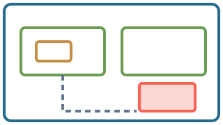
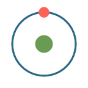
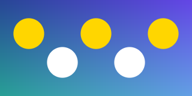

<!-- A tour of every feature of the Markdown dialect. Each slide pairs a listing with the result it produces. -->

::: styles
callout: color=ORANGE font_size=30
heading: color=BLUE_E
:::

::: slide {#tour width=36}
# Zoomdeck {x=-17.35 y=9.2}

Zoomdeck makes zooming presentations: a forest of slides written in Markdown, most often a single tree, with formulas, images, diagrams and animations, that the browser plays by zooming into each slide and back out. The first seven chapters show what it does; the six sections that follow cover the dialect and the player in full, each chapter next to the markup that produces it. Press → to follow the slides in order, pick a slide from the outline (O), or click a chapter to jump to it. {x=-17.35 y=8.1 width=27 font_size=24}

[Documentation ↗]{#doc-link x=17.35 y=9.2 anchor=right-baseline font_size=26 color=BLUE_E href=https://puppis.github.io/zoomdeck/}

[Source on GitHub ↗]{#github-link x=17.35 y=8.2 anchor=right-baseline font_size=26 color=BLUE_E href=https://github.com/puppis/zoomdeck}

[1 · A PDF, as it is]{#root-cap-feat-pdf x=-13.2 y=4.65 anchor=bottom font_size=22 color=BLUE_E href=#slide=feat-pdf}
[[include: #feat-pdf x=-13.2 y=1.9 width=8.6 skip_return=true preview=true]]
[[rectangle: #root-hit-feat-pdf x=-13.2 y=1.9 width=8.6 height=4.84 opacity=0 href=#slide=feat-pdf]]

[2 · Plain slides, in a row]{#root-cap-feat-plain x=-4.4 y=4.65 anchor=bottom font_size=22 color=BLUE_E href=#slide=feat-plain}
[[include: #feat-plain x=-4.4 y=1.9 width=8.6 skip_return=true preview=true]]
[[rectangle: #root-hit-feat-plain x=-4.4 y=1.9 width=8.6 height=4.84 opacity=0 href=#slide=feat-plain]]

[3 · Slides as a tree]{#root-cap-feat-tree x=4.4 y=4.65 anchor=bottom font_size=22 color=BLUE_E href=#slide=feat-tree}
[[include: #feat-tree x=4.4 y=1.9 width=8.6 skip_return=true preview=true]]
[[rectangle: #root-hit-feat-tree x=4.4 y=1.9 width=8.6 height=4.84 opacity=0 href=#slide=feat-tree]]

[4 · Spotlight and laser]{#root-cap-feat-spotlight x=13.2 y=4.65 anchor=bottom font_size=22 color=BLUE_E href=#slide=feat-spotlight}
[[include: #feat-spotlight x=13.2 y=1.9 width=8.6 skip_return=true preview=true]]
[[rectangle: #root-hit-feat-spotlight x=13.2 y=1.9 width=8.6 height=4.84 opacity=0 href=#slide=feat-spotlight]]

[5 · Pen, tablet and whiteboard]{#root-cap-feat-pen x=-13.2 y=-0.9500000000000002 anchor=bottom font_size=22 color=BLUE_E href=#slide=feat-pen}
[[include: #feat-pen x=-13.2 y=-4.9 width=8.6 skip_return=true preview=true]]
[[rectangle: #root-hit-feat-pen x=-13.2 y=-4.9 width=8.6 height=4.84 opacity=0 href=#slide=feat-pen]]

[6 · Camera, recording, video]{#root-cap-feat-recording x=-4.4 y=-0.9500000000000002 anchor=bottom font_size=22 color=BLUE_E href=#slide=feat-recording}
[[include: #feat-recording x=-4.4 y=-4.9 width=8.6 skip_return=true preview=true]]
[[rectangle: #root-hit-feat-recording x=-4.4 y=-4.9 width=8.6 height=4.84 opacity=0 href=#slide=feat-recording]]

[7 · Formulas, diagrams, motion]{#root-cap-feat-math x=4.4 y=-0.9500000000000002 anchor=bottom font_size=22 color=BLUE_E href=#slide=feat-math}
[[include: #feat-math x=4.4 y=-4.9 width=8.6 skip_return=true preview=true]]
[[rectangle: #root-hit-feat-math x=4.4 y=-4.9 width=8.6 height=4.84 opacity=0 href=#slide=feat-math]]

[The dialect and the player, in six sections]{#root-cap-sections x=13.2 y=-2.15 anchor=bottom font_size=22 color=BLUE_E href=#slide=sections}
[[include: #sections x=13.2 y=-4.9 width=8.6 preview=true]]
[[rectangle: #root-hit-sections x=13.2 y=-4.9 width=8.6 height=4.84 opacity=0 href=#slide=sections]]
:::

::: slide {#sections width=36}
## The dialect and the player, in six sections {x=-17.35 y=9.2}

Everything a slide can hold and everything the player does, one chapter per topic, each showing the listing that produces it. {x=-17.35 y=8.1 width=25 font_size=26}

[Back to the overview]{#sections-up x=17.35 y=8.2 anchor=right-baseline font_size=24 color=BLUE_E href=#slide=tour}

[1 · Slides and content]{#sections-cap-sec-content x=-12 y=5.5 anchor=bottom font_size=24 color=BLUE_E href=#slide=sec-content}
[[include: #sec-content x=-12 y=2.2 width=10 skip_return=true preview=true]]
[[rectangle: #sections-hit-sec-content x=-12 y=2.2 width=10 height=5.625 opacity=0 href=#slide=sec-content]]

[2 · Presenting]{#sections-cap-sec-presenting x=0 y=5.5 anchor=bottom font_size=24 color=BLUE_E href=#slide=sec-presenting}
[[include: #sec-presenting x=0 y=2.2 width=10 skip_return=true preview=true]]
[[rectangle: #sections-hit-sec-presenting x=0 y=2.2 width=10 height=5.625 opacity=0 href=#slide=sec-presenting]]

[3 · Diagrams]{#sections-cap-sec-diagrams x=12 y=5.5 anchor=bottom font_size=24 color=BLUE_E href=#slide=sec-diagrams}
[[include: #sec-diagrams x=12 y=2.2 width=10 skip_return=true preview=true]]
[[rectangle: #sections-hit-sec-diagrams x=12 y=2.2 width=10 height=5.625 opacity=0 href=#slide=sec-diagrams]]

[4 · Layout and style]{#sections-cap-sec-layout x=-12 y=-2.1 anchor=bottom font_size=24 color=BLUE_E href=#slide=sec-layout}
[[include: #sec-layout x=-12 y=-5.4 width=10 skip_return=true preview=true]]
[[rectangle: #sections-hit-sec-layout x=-12 y=-5.4 width=10 height=5.625 opacity=0 href=#slide=sec-layout]]

[5 · Motion and interaction]{#sections-cap-sec-motion x=0 y=-2.1 anchor=bottom font_size=24 color=BLUE_E href=#slide=sec-motion}
[[include: #sec-motion x=0 y=-5.4 width=10 skip_return=true preview=true]]
[[rectangle: #sections-hit-sec-motion x=0 y=-5.4 width=10 height=5.625 opacity=0 href=#slide=sec-motion]]

[6 · Forests, files and code]{#sections-cap-sec-structure x=12 y=-2.1 anchor=bottom font_size=24 color=BLUE_E href=#slide=sec-structure}
[[include: #sec-structure x=12 y=-5.4 width=10 preview=true]]
[[rectangle: #sections-hit-sec-structure x=12 y=-5.4 width=10 height=5.625 opacity=0 href=#slide=sec-structure]]
:::

::: slide {#feat-pdf width=20}
## 1 · A PDF, as it is

[Documentation ↗]{#feat-pdf-docs x=9.35 y=5.0 anchor=right-baseline font_size=17 color=GRAY href=https://puppis.github.io/zoomdeck/features.html#a-pdf-as-it-is}

Zoomdeck opens a PDF directly: a paper, a poster, slides typeset elsewhere. Each page is a slide, the pages are visited first to last with a cut between them, the bookmarks of the document name them in the outline, and the text stays sharp at any zoom, since pages are drawn at the density of the screen. {x=-9.35 y=3.9 width=8.6 font_size=20}

```bash {#feat-pdf-cmd x=-9.35 y=-1.7 width=8.6}
zoomdeck serve paper.pdf
zoomdeck build paper.pdf -o out
```

[[rectangle: #feat-pdf-frame x=4.3 y=-0.5 width=10.2 height=5.74 color=GRAY stroke_width=1]]

[[subslide: PaperPage x=4.3 y=-0.5 width=10.2 preview=true]]

The pen, the spotlight, recording and printing work on a PDF as on any deck. On the right, the first page of a PDF typeset with LaTeX, drawn inside this slide; the player, the `zoomdeck` command, the dev page and the desktop app open the whole file. {x=-9.35 y=-4.5 width=18.7 font_size=16 color=GRAY}
:::

::: slide {#feat-plain width=20}
## 2 · Plain slides, in a row

[Documentation ↗]{#feat-plain-docs x=9.35 y=5.0 anchor=right-baseline font_size=17 color=GRAY href=https://puppis.github.io/zoomdeck/features.html#plain-slides-in-a-row}

```markdown {#feat-plain-source x=-9.35 y=3.9 width=9.1}
::: slide {#one}
# One
:::

::: slide {#two}
# Two
:::

::: slide {#three}
# Three
:::
```

[[rectangle: #feat-plain-r1 x=1.6 y=1.2 width=4.6 height=2.6 color=GRAY]]
[[rectangle: #feat-plain-r2 x=6.6 y=1.2 width=4.6 height=2.6 color=GRAY]]
[[rectangle: #feat-plain-r3 x=4.1 y=-2.4 width=4.6 height=2.6 color=GRAY]]

[One]{#feat-plain-t1 x=1.6 y=1.2 anchor=center font_size=28}

[Two]{#feat-plain-t2 x=6.6 y=1.2 anchor=center font_size=28}

[Three]{#feat-plain-t3 x=4.1 y=-2.4 anchor=center font_size=28}

[[arrow: #feat-plain-r1 -> #feat-plain-r2, #feat-plain-a1, label="cut", step=1]]
[[arrow: #feat-plain-r2 -> #feat-plain-r3, #feat-plain-a2, label="cut", step=2]]

A deck of your own is a Markdown file of `::: slide` containers. Slides that include no other slide are simply visited in order, with cuts and no animation, like the pages of a document. {#feat-plain-key x=-9.35 y=-3.6 width=18.7 font_size=20}

Each slide keeps its steps, fragments and animations; a slide may still include children of its own, which zoom as usual. {#feat-plain-more x=-9.35 y=-4.75 width=18.7 font_size=16 color=GRAY}
:::

::: slide {#feat-tree width=20}
## 3 · Slides as a tree

[Documentation ↗]{#feat-tree-docs x=9.35 y=5.0 anchor=right-baseline font_size=17 color=GRAY href=https://puppis.github.io/zoomdeck/features.html#slides-as-a-tree}

```markdown {#feat-tree-source x=-9.35 y=3.9 width=9.1}
::: slide {#talk width=20}
# A talk as a tree
[[include: #first x=-5 y=-1.5 width=8]]
[[include: #second x=5 y=-1.5 width=8]]
:::

::: slide {#second}
## Second child
[[include: #detail x=3 y=-1.5 width=7]]
:::
```

[[include: #feat-first x=4.6 y=1.4 width=7 preview=true]]

[[include: #feat-second x=4.6 y=-3.1 width=7 preview=true]]

An `[[include: #id …]]` places one slide inside another, as a viewport. The camera zooms into each child in turn, goes straight from a child to its next sibling, and zooms back out after the last one. {#feat-tree-key x=-9.35 y=-3.0 width=10 font_size=18}

Here: first child, then its sibling, then down into the sibling's own child, then back out. {#feat-tree-more x=-9.35 y=-5.0 width=10 font_size=15 color=GRAY}
:::

::: slide {#feat-first}
## First child

Visited first; the camera leaves it for its sibling. {x=-7.35 width=14.7 font_size=22}
:::

::: slide {#feat-second}
## Second child

[[include: #feat-detail x=3 y=-1.5 width=7 preview=true]]

This one has a child of its own. {x=-7.35 y=1.6 width=7 font_size=22}
:::

::: slide {#feat-detail width=8}
### A detail of the second child {font_size=26}

The last stop; then the camera zooms back out. {x=-3.35 y=0.2 width=7 font_size=18}
:::

::: slide {#feat-spotlight width=20}
## 4 · Spotlight and laser

[Documentation ↗]{#feat-spotlight-docs x=9.35 y=5.0 anchor=right-baseline font_size=17 color=GRAY href=https://puppis.github.io/zoomdeck/features.html#spotlight-and-laser}

Hold **Shift** while moving the pointer over this slide: a spotlight follows it. **L** switches between the spotlight and a laser dot, and Shift with the mouse wheel (or a two-finger scroll) changes the size; the settings (⚙, or the comma key) offer the same choices. Both work on any deck, a PDF included, and are recorded with a talk. {x=-9.35 y=3.9 width=18.7 font_size=20}

[Where does this term come from?]{#feat-spot-q x=-8 y=-0.6 font_size=26}

[$\displaystyle \frac{\partial L}{\partial \dot q} - \frac{\partial L}{\partial q} = 0$]{#feat-spot-eq x=1 y=-0.6 font_size=32}

Shift + drag draws a highlight that fades; a plain drag never moves the presentation. {x=-9.35 y=-4.5 width=18.7 font_size=16 color=GRAY}
:::

::: slide {#feat-pen width=20}
## 5 · Pen, tablet and whiteboard

[Documentation ↗]{#feat-pen-docs x=9.35 y=5.0 anchor=right-baseline font_size=17 color=GRAY href=https://puppis.github.io/zoomdeck/features.html#pen-tablet-and-whiteboard}

**D** turns the pen on: a drag draws on the slide in the chosen color, the keys **1** to **4** (or the dots in the footer) pick it, ⌘Z or Ctrl+Z takes a stroke back, and the strokes stay with the slide. Pressure comes through from a pen or an Apple Pencil. {x=-9.35 y=3.9 width=9 font_size=20}

**W** opens the whiteboard: an infinite canvas of its own, scrolled with the arrows, that keeps what you wrote and comes back when you need it again. {x=0.6 y=3.9 width=8.75 font_size=20}

[Annotate this: $x^2 + y^2 = r^2$]{#feat-pen-note x=-8 y=-1.4 font_size=30}

[[icon: phone #feat-pen-tablet x=5.5 y=-1.6 size=2.2 color=GRAY]]

[a tablet as a drawing pad]{#feat-pen-tablet-cap at=bottom:#feat-pen-tablet.top dy=0.15 font_size=15 color=GRAY}

A tablet or an iPad pairs with the player from the settings (Tablet) and becomes a drawing pad: you write on it, the audience sees the slide, with pressure, palm rejection and erasing with a finger. {x=-9.35 y=-4.5 width=18.7 font_size=16 color=GRAY}
:::

::: slide {#feat-recording width=20}
## 6 · Camera, recording and video

[Documentation ↗]{#feat-recording-docs x=9.35 y=5.0 anchor=right-baseline font_size=17 color=GRAY href=https://puppis.github.io/zoomdeck/features.html#camera-recording-and-video}

The camera (**C**) shows you next to or over the slides, in a corner or full screen. A recording (**R**) keeps the whole talk on one clock: your voice, the camera and every move on the deck, strokes included; it plays back on the deck itself, where it stays navigable, as the **▶ Talk** button beside Record, and exports as a plain video file. A shared screen (**S**), another application say, is filmed as part of the talk; **P** prints the deck to a PDF. {x=-9.35 y=3.9 width=11.2 font_size=19}

[[icon: user #feat-rec-you x=-7.6 y=-1.6 size=2 color=GRAY]]
[[icon: desktop #feat-rec-deck x=-3.6 y=-1.6 size=2 color=GRAY]]
[[icon: document #feat-rec-file x=-5.6 y=-4.2 size=1.6 color=GRAY]]
[[arrow: #feat-rec-you -> #feat-rec-file, #feat-rec-a, color=GRAY, stroke_width=1]]
[[arrow: #feat-rec-deck -> #feat-rec-file, #feat-rec-b, color=GRAY, stroke_width=1]]

[voice, camera (C)]{#feat-rec-cap-you at=bottom:#feat-rec-you.top dy=0.15 font_size=15 color=GRAY}

[moves on the deck]{#feat-rec-cap-deck at=bottom:#feat-rec-deck.top dy=0.15 font_size=15 color=GRAY}

[a talk (R), a video]{#feat-rec-cap-file at=left:#feat-rec-file.right dx=0.25 font_size=15 color=GRAY}

Try it here: press R, speak, draw, turn the camera on with C, stop, then press ▶ Talk; each asks the browser for permission the first time. {x=2.3 y=-0.4 width=7.2 font_size=17 color=GRAY}
:::

::: slide {#feat-math width=20}
## 7 · Formulas, diagrams and motion

[Documentation ↗]{#feat-math-docs x=9.35 y=5.0 anchor=right-baseline font_size=17 color=GRAY href=https://puppis.github.io/zoomdeck/features.html#formulas-diagrams-and-animation}

[$\displaystyle \int_{-\infty}^{\infty} e^{-x^2}\,dx = \sqrt{\pi}$]{#feat-gauss x=-8.6 y=2.6 font_size=36}

[[box: #feat-gauss, #feat-gbox, buff=0.3, corner_radius=0.15, color=TEAL, step=1]]

[Gaussian integral]{#feat-glabel x=-8.6 y=-0.2 font_size=22 color=TEAL enter=write step=1}

[[arrow: #feat-glabel -> #feat-gauss, #feat-why, step=2]]

[[rectangle: #feat-hr x=2.4 y=2.4 width=3.2 height=1.7 color=BLUE_E fill_opacity=0.5 sketch=true step=3]]

[[circle: #feat-hc right-of:#feat-hr buff=1.4 radius=0.85 color=GREEN_E fill_opacity=0.6 fill_style=cross-hatch sketch=true step=3]]

[[arrow: #feat-hr -> #feat-hc, #feat-ha, sketch=true, step=4]]

[[blob: #feat-hr #feat-hc, #feat-cloud, buff=0.45, color=ORANGE, step=5]]

[A point moves]{#feat-mover x=-8.6 y=-1.6 font_size=26}

[[animate: #feat-mover, dx=6.5, step=6]]

[[animate: #feat-mover, dy=-1.2, scale=1.3, color=RED, step=7]]

[[effect: indicate #feat-mover, step=8]]

[Written by hand]{#feat-written x=3.4 y=-2.6 font_size=26 enter=write step=9}

Formulas are LaTeX, rendered by MathJax and zoomable like everything else. Diagrams are directives: arrows, boxes and blobs around elements, icons, and any of them hand-drawn with `sketch=true`. Animations in the style of Manim come with the same directives: write, move, morph, highlight, one step per click. {#feat-math-key x=-9.35 y=-4.3 width=18.7 font_size=16 color=GRAY}
:::

::: slide {#sec-content width=36}
## 1 · Slides and content {x=-17.35 y=9.2}

A deck is a forest of slides, and a slide holds prose, formulas, images, listings, tables and charts. These chapters cover everything a slide can contain. {x=-17.35 y=8.1 width=25 font_size=26}

[Documentation: Slides and content ↗]{#sec-content-docs x=17.35 y=9.2 anchor=right-baseline font_size=24 color=BLUE_E href=https://puppis.github.io/zoomdeck/slides.html}

[Back to the overview]{#sec-content-up x=17.35 y=8.2 anchor=right-baseline font_size=24 color=BLUE_E href=#slide=tour}

[Slides form a forest]{#sec-content-cap-tree x=-12 y=6.199999999999999 anchor=bottom font_size=24 color=BLUE_E href=#slide=tree}
[[include: #tree x=-12 y=2.9 width=10 skip_return=true preview=true]]
[[rectangle: #sec-content-hit-tree x=-12 y=2.9 width=10 height=5.625 opacity=0 href=#slide=tree]]

[Prose and inline styling]{#sec-content-cap-prose x=0 y=6.199999999999999 anchor=bottom font_size=24 color=BLUE_E href=#slide=prose}
[[include: #prose x=0 y=2.9 width=10 skip_return=true preview=true]]
[[rectangle: #sec-content-hit-prose x=0 y=2.9 width=10 height=5.625 opacity=0 href=#slide=prose]]

[Mathematics]{#sec-content-cap-math x=12 y=6.199999999999999 anchor=bottom font_size=24 color=BLUE_E href=#slide=math}
[[include: #math x=12 y=2.9 width=10 skip_return=true preview=true]]
[[rectangle: #sec-content-hit-math x=12 y=2.9 width=10 height=5.625 opacity=0 href=#slide=math]]

[Images and animated images]{#sec-content-cap-images x=-12 y=-1.2999999999999998 anchor=bottom font_size=24 color=BLUE_E href=#slide=images}
[[include: #images x=-12 y=-4.6 width=10 skip_return=true preview=true]]
[[rectangle: #sec-content-hit-images x=-12 y=-4.6 width=10 height=5.625 opacity=0 href=#slide=images]]

[Code listings]{#sec-content-cap-listings x=0 y=-1.2999999999999998 anchor=bottom font_size=24 color=BLUE_E href=#slide=listings}
[[include: #listings x=0 y=-4.6 width=10 skip_return=true preview=true]]
[[rectangle: #sec-content-hit-listings x=0 y=-4.6 width=10 height=5.625 opacity=0 href=#slide=listings]]

[Tables and charts]{#sec-content-cap-tables x=12 y=-1.2999999999999998 anchor=bottom font_size=24 color=BLUE_E href=#slide=tables}
[[include: #tables x=12 y=-4.6 width=10 preview=true]]
[[rectangle: #sec-content-hit-tables x=12 y=-4.6 width=10 height=5.625 opacity=0 href=#slide=tables]]
:::

::: slide {#sec-presenting width=36}
## 2 · Presenting {x=-17.35 y=9.2}

Playing a deck: keys, the spotlight and laser, the pen and the whiteboard, the camera, links and the PDF printout in the player; a page to try a pen or a tablet; and recording a talk that plays back on the deck or exports as a video. {x=-17.35 y=8.1 width=25 font_size=26}

[Documentation: Presenting ↗]{#sec-presenting-docs x=17.35 y=9.2 anchor=right-baseline font_size=24 color=BLUE_E href=https://puppis.github.io/zoomdeck/player.html}

[Back to the overview]{#sec-presenting-up x=17.35 y=8.2 anchor=right-baseline font_size=24 color=BLUE_E href=#slide=tour}

[The player]{#sec-presenting-cap-player x=-12 y=2.6999999999999997 anchor=bottom font_size=24 color=BLUE_E href=#slide=player}
[[include: #player x=-12 y=-0.6 width=10 skip_return=true preview=true]]
[[rectangle: #sec-presenting-hit-player x=-12 y=-0.6 width=10 height=5.625 opacity=0 href=#slide=player]]

[Pen, whiteboard and tablet]{#sec-presenting-cap-tablet x=0 y=2.6999999999999997 anchor=bottom font_size=24 color=BLUE_E href=#slide=tablet}
[[include: #tablet x=0 y=-0.6 width=10 skip_return=true preview=true]]
[[rectangle: #sec-presenting-hit-tablet x=0 y=-0.6 width=10 height=5.625 opacity=0 href=#slide=tablet]]

[Recording a talk]{#sec-presenting-cap-recording x=12 y=2.6999999999999997 anchor=bottom font_size=24 color=BLUE_E href=#slide=recording}
[[include: #recording x=12 y=-0.6 width=10 preview=true]]
[[rectangle: #sec-presenting-hit-recording x=12 y=-0.6 width=10 height=5.625 opacity=0 href=#slide=recording]]
:::

::: slide {#sec-diagrams width=36}
## 3 · Diagrams {x=-17.35 y=9.2}

Shapes, arrows and lines, braces and boxes, icons and blobs, drawn crisply or by hand: the building blocks of diagrams. {x=-17.35 y=8.1 width=25 font_size=26}

[Documentation: Diagrams ↗]{#sec-diagrams-docs x=17.35 y=9.2 anchor=right-baseline font_size=24 color=BLUE_E href=https://puppis.github.io/zoomdeck/shapes.html}

[Back to the overview]{#sec-diagrams-up x=17.35 y=8.2 anchor=right-baseline font_size=24 color=BLUE_E href=#slide=tour}

[Shapes and connections]{#sec-diagrams-cap-shapes x=-12 y=6.199999999999999 anchor=bottom font_size=24 color=BLUE_E href=#slide=shapes}
[[include: #shapes x=-12 y=2.9 width=10 skip_return=true preview=true]]
[[rectangle: #sec-diagrams-hit-shapes x=-12 y=2.9 width=10 height=5.625 opacity=0 href=#slide=shapes]]

[Braces, boxes and opacity]{#sec-diagrams-cap-more-shapes x=0 y=6.199999999999999 anchor=bottom font_size=24 color=BLUE_E href=#slide=more-shapes}
[[include: #more-shapes x=0 y=2.9 width=10 skip_return=true preview=true]]
[[rectangle: #sec-diagrams-hit-more-shapes x=0 y=2.9 width=10 height=5.625 opacity=0 href=#slide=more-shapes]]

[Hand-drawn shapes]{#sec-diagrams-cap-sketch x=12 y=6.199999999999999 anchor=bottom font_size=24 color=BLUE_E href=#slide=sketch}
[[include: #sketch x=12 y=2.9 width=10 skip_return=true preview=true]]
[[rectangle: #sec-diagrams-hit-sketch x=12 y=2.9 width=10 height=5.625 opacity=0 href=#slide=sketch]]

[Icons for diagrams]{#sec-diagrams-cap-icons x=-6 y=-1.2999999999999998 anchor=bottom font_size=24 color=BLUE_E href=#slide=icons}
[[include: #icons x=-6 y=-4.6 width=10 skip_return=true preview=true]]
[[rectangle: #sec-diagrams-hit-icons x=-6 y=-4.6 width=10 height=5.625 opacity=0 href=#slide=icons]]

[Boxes and blobs]{#sec-diagrams-cap-enclosures x=6 y=-1.2999999999999998 anchor=bottom font_size=24 color=BLUE_E href=#slide=enclosures}
[[include: #enclosures x=6 y=-4.6 width=10 preview=true]]
[[rectangle: #sec-diagrams-hit-enclosures x=6 y=-4.6 width=10 height=5.625 opacity=0 href=#slide=enclosures]]
:::

::: slide {#sec-layout width=36}
## 4 · Layout and style {x=-17.35 y=9.2}

Where elements go and how they look: the vertical flow, coordinates and anchors, relative constraints, groups, style sheets, and the deck.json file that sets the deck's title, proportions, fonts and colors. {x=-17.35 y=8.1 width=25 font_size=26}

[Documentation: Layout and style ↗]{#sec-layout-docs x=17.35 y=9.2 anchor=right-baseline font_size=24 color=BLUE_E href=https://puppis.github.io/zoomdeck/positioning.html}

[Back to the overview]{#sec-layout-up x=17.35 y=8.2 anchor=right-baseline font_size=24 color=BLUE_E href=#slide=tour}

[Positioning and relative layout]{#sec-layout-cap-layout x=-12 y=6.199999999999999 anchor=bottom font_size=24 color=BLUE_E href=#slide=layout}
[[include: #layout x=-12 y=2.9 width=10 skip_return=true preview=true]]
[[rectangle: #sec-layout-hit-layout x=-12 y=2.9 width=10 height=5.625 opacity=0 href=#slide=layout]]

[Anchors, offsets and timing]{#sec-layout-cap-anchors x=0 y=6.199999999999999 anchor=bottom font_size=24 color=BLUE_E href=#slide=anchors}
[[include: #anchors x=0 y=2.9 width=10 skip_return=true preview=true]]
[[rectangle: #sec-layout-hit-anchors x=0 y=2.9 width=10 height=5.625 opacity=0 href=#slide=anchors]]

[Anchor expressions and styles]{#sec-layout-cap-styles x=12 y=6.199999999999999 anchor=bottom font_size=24 color=BLUE_E href=#slide=styles}
[[include: #styles x=12 y=2.9 width=10 skip_return=true preview=true]]
[[rectangle: #sec-layout-hit-styles x=12 y=2.9 width=10 height=5.625 opacity=0 href=#slide=styles]]

[Groups]{#sec-layout-cap-groups x=-6 y=-1.2999999999999998 anchor=bottom font_size=24 color=BLUE_E href=#slide=groups}
[[include: #groups x=-6 y=-4.6 width=10 skip_return=true preview=true]]
[[rectangle: #sec-layout-hit-groups x=-6 y=-4.6 width=10 height=5.625 opacity=0 href=#slide=groups]]

[deck.json and the command line]{#sec-layout-cap-config x=6 y=-1.2999999999999998 anchor=bottom font_size=24 color=BLUE_E href=#slide=config}
[[include: #config x=6 y=-4.6 width=10 preview=true]]
[[rectangle: #sec-layout-hit-config x=6 y=-4.6 width=10 height=5.625 opacity=0 href=#slide=config]]
:::

::: slide {#sec-motion width=36}
## 5 · Motion and interaction {x=-17.35 y=9.2}

What happens on each click: fragments that appear and disappear, decorations seen only in focus, animations, video, live pages and going back. {x=-17.35 y=8.1 width=25 font_size=26}

[Documentation: Motion and interaction ↗]{#sec-motion-docs x=17.35 y=9.2 anchor=right-baseline font_size=24 color=BLUE_E href=https://puppis.github.io/zoomdeck/fragments.html}

[Back to the overview]{#sec-motion-up x=17.35 y=8.2 anchor=right-baseline font_size=24 color=BLUE_E href=#slide=tour}

[Fragments and click steps]{#sec-motion-cap-fragments x=-12 y=6.199999999999999 anchor=bottom font_size=24 color=BLUE_E href=#slide=fragments}
[[include: #fragments x=-12 y=2.9 width=10 skip_return=true preview=true]]
[[rectangle: #sec-motion-hit-fragments x=-12 y=2.9 width=10 height=5.625 opacity=0 href=#slide=fragments]]

[Decorations visible only in focus]{#sec-motion-cap-focus x=0 y=6.199999999999999 anchor=bottom font_size=24 color=BLUE_E href=#slide=focus}
[[include: #focus x=0 y=2.9 width=10 skip_return=true preview=true]]
[[rectangle: #sec-motion-hit-focus x=0 y=2.9 width=10 height=5.625 opacity=0 href=#slide=focus]]

[Animations from markup]{#sec-motion-cap-animations x=12 y=6.199999999999999 anchor=bottom font_size=24 color=BLUE_E href=#slide=animations}
[[include: #animations x=12 y=2.9 width=10 skip_return=true preview=true]]
[[rectangle: #sec-motion-hit-animations x=12 y=2.9 width=10 height=5.625 opacity=0 href=#slide=animations]]

[Video, live pages and going back]{#sec-motion-cap-media x=0 y=-1.2999999999999998 anchor=bottom font_size=24 color=BLUE_E href=#slide=media}
[[include: #media x=0 y=-4.6 width=10 preview=true]]
[[rectangle: #sec-motion-hit-media x=0 y=-4.6 width=10 height=5.625 opacity=0 href=#slide=media]]
:::

::: slide {#sec-structure width=36}
## 6 · Forests, files and code {x=-17.35 y=9.2}

Larger decks: the order in which children are visited, splitting the markup into files, and slides written in TypeScript. {x=-17.35 y=8.1 width=25 font_size=26}

[Documentation: Forests, files and code ↗]{#sec-structure-docs x=17.35 y=9.2 anchor=right-baseline font_size=24 color=BLUE_E href=https://puppis.github.io/zoomdeck/slides.html#visit-order}

[Back to the overview]{#sec-structure-up x=17.35 y=8.2 anchor=right-baseline font_size=24 color=BLUE_E href=#slide=tour}

[Children, visit order and placeholders]{#sec-structure-cap-children x=-12 y=2.6999999999999997 anchor=bottom font_size=24 color=BLUE_E href=#slide=children}
[[include: #children x=-12 y=-0.6 width=10 skip_return=true preview=true]]
[[rectangle: #sec-structure-hit-children x=-12 y=-0.6 width=10 height=5.625 opacity=0 href=#slide=children]]

[Importing markup from files]{#sec-structure-cap-imports x=0 y=2.6999999999999997 anchor=bottom font_size=24 color=BLUE_E href=#slide=imports}
[[include: #imports x=0 y=-0.6 width=10 skip_return=true preview=true]]
[[rectangle: #sec-structure-hit-imports x=0 y=-0.6 width=10 height=5.625 opacity=0 href=#slide=imports]]

[Code-authored slides]{#sec-structure-cap-code-slides x=12 y=2.6999999999999997 anchor=bottom font_size=24 color=BLUE_E href=#slide=code-slides}
[[include: #code-slides x=12 y=-0.6 width=10 preview=true]]
[[rectangle: #sec-structure-hit-code-slides x=12 y=-0.6 width=10 height=5.625 opacity=0 href=#slide=code-slides]]
:::

::: slide {#tree width=20}
## Slides form a forest

[Documentation ↗]{#tree-docs x=9.35 y=5.0 anchor=right-baseline font_size=17 color=GRAY href=https://puppis.github.io/zoomdeck/slides.html}

```markdown {#tree-source x=-9.35 y=3.9 width=9.1}
::: slide {#tree width=20}
## Slides form a forest
[[include: #branch x=4.7 y=-0.4 width=9 angle=0.08 preview=true]]
:::

::: slide {#branch}
## A branch
[[include: #leaf x=3 y=-1.5 width=6 angle=-0.15]]
:::

::: slide {#leaf width=8}
## A leaf: an 8 × 4.5 canvas
:::
```

[[include: #branch x=4.7 y=-0.4 width=9 angle=0.08 preview=true]]

Every slide is a `::: slide {#id}` container with its own canvas, 16 × 9 by default. Slides that nothing includes are roots, visited first to last with cuts between them; `[[include: #id …]]` places a child viewport in the parent’s coordinates, and the camera zooms into each child in turn and back out after the last. {#tree-key x=-9.35 y=-3.5 width=18.7 font_size=18}

Includes without `step` are visited in source order after the parent’s own steps. `width` or `height` sizes the viewport (the other follows the child’s proportions) and `angle` tilts it, in radians. {#tree-more x=-9.35 y=-4.9 width=18.7 font_size=16 color=GRAY}
:::

::: slide {#branch}
## A branch

A child has a canvas of its own and may include children in turn. {x=-7.35 width=14.7 font_size=22}

[[include: #leaf x=3 y=-1.5 width=6 angle=-0.15]]
:::

::: slide {#leaf width=8}
## A leaf: an 8 × 4.5 canvas {font_size=26}

Returning zooms back out to the parent. {x=-3.35 y=0.2 width=7 font_size=20}
:::

::: slide {#prose width=20}
## Prose and inline styling

[Documentation ↗]{#prose-docs x=9.35 y=5.0 anchor=right-baseline font_size=17 color=GRAY href=https://puppis.github.io/zoomdeck/text.html}

```markdown {#prose-source x=-9.35 y=3.9 width=9.1}
Paragraphs wrap to `width`. Use **bold**, *italic*,
`inline code` and math $e^{i\pi}+1=0$.

[Colored spans]{color=ORANGE} take palette names,
[CSS colors]{style="color:#15803D"} or hex values
and [nest **emphasis** and $\sqrt{2}$]{color=GOLD_E}.

First line.\\
Second line after an explicit break.

- Bullet items are prose with a marker
  - Nested items indent
    1. Numbered lists nest too
- Headings set size only: `#` to `######`

### A level-3 heading

Links like [this one](https://vite.dev) are clickable.

<!-- HTML comments are discarded. -->
```

Paragraphs wrap to `width`. Use **bold**, *italic*, `inline code` and math $e^{i\pi}+1=0$. {x=0.6 width=9}

[Colored spans]{color=ORANGE} take palette names, [CSS colors]{style="color:#15803D"} or hex values and [nest **emphasis** and $\sqrt{2}$]{color=GOLD_E}. {x=0.6 width=9}

First line.\\
Second line after an explicit break. {x=0.6 width=9}

- Bullet items are prose with a marker {x=0.6 width=9}
  - Nested items indent {x=0.6 width=8.4}
    1. Numbered lists nest too {x=0.6 width=7.8}
- Headings set size only: `#` to `######` {x=0.6 width=9}

### A level-3 heading {x=0.6}

Links like [this one](https://vite.dev) are clickable. {x=0.6 width=9}

Blank lines separate elements, and the attributes in braces at the end of a block apply to it: `{#id x= y= width= font_size= color= step=}`. {#prose-key x=-9.35 y=-4.2 width=18.7 font_size=20}

Headings `#` to `######` set the size only; HTML comments are discarded. A `::: styles` block or deck.json can restyle every role at once, see Anchor expressions and styles. {#prose-more x=-9.35 y=-5.05 width=18.7 font_size=16 color=GRAY}
:::

::: slide {#math width=20}
## Mathematics

[Documentation ↗]{#math-docs x=9.35 y=5.0 anchor=right-baseline font_size=17 color=GRAY href=https://puppis.github.io/zoomdeck/math.html}

```markdown {#math-source x=-9.35 y=3.9 width=9.1}
Inline math shares the baseline: $\int_0^1 x^2\,dx = \tfrac13$.

$$
\sum_{k=0}^{n} \binom{n}{k} = 2^n
$$

::: {.element #pythagoras x=0.6 y=-0.4 font_size=34}
$$ \textcolor{Orange}{a}^2 + {\color{Cerulean} b^2} = c^2 $$
:::

Macros from deck.json: $\N \subset \R$.
```

Inline math shares the baseline: $\int_0^1 x^2\,dx = \tfrac13$. {x=0.6 width=9}

::: {.element x=0.6 width=9}
$$
\sum_{k=0}^{n} \binom{n}{k} = 2^n
$$
:::

::: {.element #pythagoras x=0.6 y=-0.4 font_size=34}
$$ \textcolor{Orange}{a}^2 + {\color{Cerulean} b^2} = c^2 $$
:::

Macros from deck.json: $\N \subset \R$. {x=0.6 y=-1.8 width=9}

Single dollars give inline math and `$$` lines a display formula; LaTeX renders through MathJax, with the `macros` of deck.json at hand. {#math-key x=-9.35 y=-3.6 width=18.7 font_size=20}

A `::: {.element …}` container positions, sizes or animates a formula; `\\textcolor` and `\\color` accept dvipsnames and CSS colors. {#math-more x=-9.35 y=-4.75 width=18.7 font_size=16 color=GRAY}
:::

::: slide {#images width=20}
## Images and animated images

[Documentation ↗]{#images-docs x=9.35 y=5.0 anchor=right-baseline font_size=17 color=GRAY href=https://puppis.github.io/zoomdeck/images.html}

```markdown {#images-source x=-9.35 y=3.9 width=18.7}
{#svg x=-6 y=-1.1 width=4}

{#once x=0 y=-1.1 width=3 play=once step=1}

{#loop right-of:#once buff=1.5 width=3 play=loop step=2 hide=3}
```

{#svg x=-6 y=-1.1 width=4}

{#once x=0 y=-1.1 width=3 play=once step=1}

{#loop right-of:#once buff=1.5 width=3 play=loop step=2 hide=3}

Images are centered on `x`, `y` and sized by `width`; SVG files keep their nested transforms and styles. {#images-key x=-9.35 y=-3.6 width=18.7 font_size=20}

Raster files may be PNG, JPEG, GIF or WebP. A multi-frame APNG or GIF animates with `play=once` (one pass, as a stop of its own) or `play=loop` (until the next click). {#images-more x=-9.35 y=-4.75 width=18.7 font_size=16 color=GRAY}
:::

::: slide {#player width=20}
## The player

[Documentation ↗]{#player-docs x=9.35 y=5.0 anchor=right-baseline font_size=17 color=GRAY href=https://puppis.github.io/zoomdeck/player.html}

**Keys.** → or Space next · ← previous (plays the stop backwards) · Home first stop · A replay · F fullscreen · O outline · , settings. {#player-keys x=-9.35 y=3.9 width=9 font_size=20}

**Tools.** L spotlight or laser (hold Shift to show it) · W whiteboard · C camera · S screen · R record · P print. {#player-tools below:#player-keys left-aligned:#player-keys buff=0.5 width=9 font_size=20}

**Pointer.** D turns drawing on (so does the whiteboard): a drag then draws with the pen (with pressure on a pencil or stylus), the pointer is a pencil in its color, and links are inert; Shift + drag highlights. The colors in the footer, and the keys 1 to 4, toggle drawing: a color turns it on in that color, and the color in use turns it off again. A click never changes the stop unless the settings bind a key to it. {#player-pointer below:#player-tools left-aligned:#player-tools buff=0.5 width=9 font_size=20}

**Links.** `#step=N` or `#slide=id` opens a stop directly, also as `href=` on any element, followed with a click (the front page is built that way; a drag over it still draws); the outline lists every slide. {#player-links x=0.6 y=3.9 width=9 font_size=20}

**Tablet.** A tablet on the same network pairs from the settings and draws on the deck. {#player-tablet below:#player-links left-aligned:#player-links buff=0.5 width=9 font_size=20}

**Export.** `zoomdeck build deck.json -o out` writes a static folder, `--one-file` a single HTML file with the player, fonts and assets embedded (this tour is such a file). Print writes a PDF, a page per stage or per slide. {#player-export below:#player-tablet left-aligned:#player-tablet buff=0.5 width=9 font_size=20}

Every key and gesture can be changed in the settings (,), which also hold the pen, the recording devices and the tablet pairing. {#player-more x=-9.35 y=-4.6 width=18.7 font_size=16 color=GRAY}
:::

::: slide {#tablet width=20}
## Pen, whiteboard and tablet

[Documentation ↗]{#tablet-docs x=9.35 y=5.0 anchor=right-baseline font_size=17 color=GRAY href=https://puppis.github.io/zoomdeck/player.html#the-pen}

[Trace the wave and the circle]{#tablet-cap-trace x=-9.35 y=3.9 anchor=left-baseline font_size=19 color=GRAY}

[[polyline: #tablet-wave points="(-9.2,2.6) (-8.2,3.4) (-7.2,1.8) (-6.2,3.4) (-5.2,1.8) (-4.2,3.4) (-3.2,1.8) (-2.2,3.4) (-1.2,2.6)" color=GRAY stroke_width=2]]

[[circle: #tablet-circle x=-7.6 y=-0.3 radius=1.2 color=GRAY stroke_width=2]]

[[rectangle: #tablet-box x=-3.4 y=-0.3 width=5 height=2.4 corner_radius=0.25 color=GRAY stroke_width=2]]

[write a word here, palm on the glass]{#tablet-word at=center:#tablet-box font_size=17 color=GRAY}

[Light, then harder: one stroke along the strip]{#tablet-cap-press x=-9.35 y=-2.3 anchor=left-baseline font_size=19 color=GRAY}

[[line: (-9.2,-3.1) -> (-1.0,-3.1), #tablet-strip, color=GRAY, stroke_width=1]]

[[arrow: (-9.2,-3.6) -> (-1.0,-3.6), #tablet-arrow, color=GRAY, stroke_width=1]]

1. **Pair.** Start the preview so that the tablet can reach it, for this tour `zoomdeck serve examples/tour/deck.json --host` from the checkout (or `npm run dev -- --host`), open the settings here (⚙ or ,), choose "Show the pairing code" under Tablet and scan it with the tablet, over Wi-Fi or over the cable with Internet Sharing to the iPad switched on. {x=0.6 width=9 font_size=18}
2. **Trace** the wave and the circle on the tablet: the lines should appear here as you draw, without a visible delay. {x=0.6 width=9 font_size=18}
3. **Press** lightly, then harder, along the strip: the width should follow. The Pen settings decide how much and redraw the strokes. {x=0.6 width=9 font_size=18}
4. **Rest your palm** on the glass while writing in the box: a finger never draws. {x=0.6 width=9 font_size=18}
5. **Whiteboard:** press W here, or the button on the tablet; draw, scroll with two fingers or the arrows; undo touches only the board. {x=0.6 width=9 font_size=18}
6. **Hover** the pencil above the glass: a red dot follows it on this screen. {x=0.6 width=9 font_size=18}
7. **Erase** a stroke by rubbing it with a fingertip; undo brings it back. {x=0.6 width=9 font_size=18}

Without a tablet the same checks work with a mouse, whose strokes take their width from the speed of the hand, or with a graphics tablet plugged into the computer, which draws with pressure directly. {x=-9.35 y=-4.5 width=19 font_size=18 color=GRAY}
:::

::: slide {#recording width=20}
## Recording a talk

[Documentation ↗]{#recording-docs x=9.35 y=5.0 anchor=right-baseline font_size=17 color=GRAY href=https://puppis.github.io/zoomdeck/player.html#recording-a-talk}

A recording keeps your voice, the camera while you have it on, and every move on the deck on one clock: stops, strokes, the whiteboard, the pointer and the camera switch. The slides are never filmed, so the talk plays back on the deck itself and exports as a video. {x=-9.35 y=3.9 width=11.2 font_size=19}

[[icon: user #recording-you x=-7.6 y=-0.6 size=2 color=GRAY]]
[[icon: desktop #recording-deck x=-3.6 y=-0.6 size=2 color=GRAY]]
[[icon: document #recording-file x=-5.6 y=-3.4 size=1.8 color=GRAY]]
[[arrow: #recording-you -> #recording-file, #recording-flow-a, color=GRAY, stroke_width=1]]
[[arrow: #recording-deck -> #recording-file, #recording-flow-b, color=GRAY, stroke_width=1]]

[voice, camera]{#recording-cap-you at=bottom:#recording-you.top dy=0.15 font_size=15 color=GRAY}

[moves on the deck]{#recording-cap-deck at=bottom:#recording-deck.top dy=0.15 font_size=15 color=GRAY}

[media + timeline]{#recording-cap-file at=left:#recording-file.right dx=0.25 font_size=15 color=GRAY}

1. **Set up** once: ⚙ settings ▸ Recording ▸ Detect devices; choose the microphone and the camera, test them, and pick the corner and size of your picture. {x=2.3 width=7.4 font_size=17}
2. **Record** with R or the ● Record button; a dialog says what will be kept, then the header counts the time. Present as usual: keys, pen, W for the whiteboard, the Camera button or C for the camera (in a corner, full frame, off), recorded while it is on; S films the screen while you work in another application. Pause leaves a gap out. {x=2.3 width=7.4 font_size=17}
3. **Stop** saves the talk in `recordings/` next to the deck when the deck is served by `zoomdeck serve` (downloads otherwise). R later offers to continue it where it stopped. {x=2.3 width=7.4 font_size=17}
4. **Play** it with ▶ Talk in the footer: the deck follows the recording; Space pauses, ← and → seek, Esc leaves. {x=2.3 width=7.4 font_size=17}
5. **Export video** in the playback bar renders it in real time: slides or whiteboard with ink, camera in a corner or full frame, and the sound. {x=2.3 width=7.4 font_size=17}

Try it on this very slide: record a few seconds, draw, turn the camera on with C, stop, then play. {x=-9.35 y=-4.5 width=19 font_size=18 color=GRAY}
:::

::: slide {#shapes width=20}
## Shapes and connections

[Documentation ↗]{#shapes-docs x=9.35 y=5.0 anchor=right-baseline font_size=17 color=GRAY href=https://puppis.github.io/zoomdeck/shapes.html}

```markdown {#shapes-source x=-9.35 y=3.9 width=18.7}
[[rectangle: #box x=-6.5 y=-1.5 width=3.4 height=1.8 corner_radius=0.3 color=BLUE_E fill_opacity=0.15]]
[[circle: #disk right-of:#box buff=2.5 radius=0.9 color=GREEN_E href=https://puppis.github.io/zoomdeck/]]
[[polyline: #zigzag points="(3,-2.4) (5,-0.6) (7,-2.2) (9,-0.4)" color=ORANGE]]
[[arrow: #box -> #disk, #edge, label="**labelled** $\to$"]]
[[line: #disk -> (1,-3.1), #drop, color=GRAY]]
```

[[rectangle: #box x=-6.5 y=-1.5 width=3.4 height=1.8 corner_radius=0.3 color=BLUE_E fill_opacity=0.15]]

[[circle: #disk right-of:#box buff=2.5 radius=0.9 color=GREEN_E href=https://puppis.github.io/zoomdeck/]]

[[polyline: #zigzag points="(3,-2.4) (5,-0.6) (7,-2.2) (9,-0.4)" color=ORANGE]]

[[arrow: #box -> #disk, #edge, label="**labelled** $\to$"]]

[[line: #disk -> (1,-3.1), #drop, color=GRAY]]

Shapes need an `#id`; `color`, `stroke_width`, `fill_color` and `fill_opacity` style them, and every positioning attribute places them. {#shapes-key x=-9.35 y=-3.6 width=18.7 font_size=20}

Arrows and lines join element IDs at their facing edges, or literal `(x,y)` points; labels take inline styling and math. `href=` makes any element a clickable link (try the circle). {#shapes-more x=-9.35 y=-4.75 width=18.7 font_size=16 color=GRAY}
:::

::: slide {#more-shapes width=20}
## More shapes, braces and boxes

[Documentation ↗]{#more-shapes-docs x=9.35 y=5.0 anchor=right-baseline font_size=17 color=GRAY href=https://puppis.github.io/zoomdeck/shapes.html#attachments}

```markdown {#more-shapes-source x=-9.35 y=3.9 width=18.7}
[[dot: #p x=-8.5 y=-1.5 color=GOLD_E]]
[[ellipse: #e x=-5.5 y=-1.5 width=3.4 height=1.6 color=TEAL_E fill_opacity=0.2]]
[[polygon: #tri points="(-2.3,-2.4) (-0.3,-0.4) (0.7,-2.4)" color=ORANGE fill_opacity=0.3]]
[[arc: #a x=4 y=-1.9 radius=1.4 angle=2.4 color=RED opacity=0.4]]
[[brace: #e, #be, side=bottom, label="an ellipse"]]
[[box: #tri, #bx, buff=0.2, corner_radius=0.1, color=GREEN_E, step=1]]
```

[[dot: #p x=-8.5 y=-1.5 color=GOLD_E]]

[[ellipse: #e x=-5.5 y=-1.5 width=3.4 height=1.6 color=TEAL_E fill_opacity=0.2]]

[[polygon: #tri points="(-2.3,-2.4) (-0.3,-0.4) (0.7,-2.4)" color=ORANGE fill_opacity=0.3]]

[[arc: #a x=4 y=-1.9 radius=1.4 angle=2.4 color=RED opacity=0.4]]

[[brace: #e, #be, side=bottom, label="an ellipse"]]

[[box: #tri, #bx, buff=0.2, corner_radius=0.1, color=GREEN_E, step=1]]

Point-defined shapes (`polygon`, `polyline`, `arc`) keep their coordinates unless positioned; a `brace` or `box` is attached to an element after layout and has its own `step`. {#more-shapes-key x=-9.35 y=-3.6 width=18.7 font_size=20}

`opacity` applies to any element and survives its fades; `corner_radius`, `buff` and `side` shape an attachment. {#more-shapes-more x=-9.35 y=-4.75 width=18.7 font_size=16 color=GRAY}
:::

::: slide {#sketch width=20}
## Hand-drawn shapes

[Documentation ↗]{#sketch-docs x=9.35 y=5.0 anchor=right-baseline font_size=17 color=GRAY href=https://puppis.github.io/zoomdeck/sketch.html}

```markdown {#sketch-source x=-9.35 y=3.9 width=18.7}
[[rectangle: #hr x=-6.5 y=-1.5 width=3.4 height=1.8 color=BLUE_E fill_opacity=0.5 sketch=true]]
[[circle: #hc right-of:#hr buff=1.5 radius=0.9 color=GREEN_E fill_opacity=0.6 fill_style=cross-hatch sketch=true]]
[[polygon: #hp points="(1,-2.4) (2.5,-0.5) (4,-2.4)" color=ORANGE fill_opacity=1 fill_style=solid roughness=2 sketch=true]]
[[arrow: #hr -> #hc, #ha, sketch=true]]
[[brace: #hp, #hb, side=bottom, label="by hand", sketch=true]]
```

[[rectangle: #hr x=-6.5 y=-1.5 width=3.4 height=1.8 color=BLUE_E fill_opacity=0.5 sketch=true]]

[[circle: #hc right-of:#hr buff=1.5 radius=0.9 color=GREEN_E fill_opacity=0.6 fill_style=cross-hatch sketch=true]]

[[polygon: #hp points="(1,-2.4) (2.5,-0.5) (4,-2.4)" color=ORANGE fill_opacity=1 fill_style=solid roughness=2 sketch=true]]

[[arrow: #hr -> #hc, #ha, sketch=true]]

[[brace: #hp, #hb, side=bottom, label="by hand", sketch=true]]

`sketch=true` draws a shape, icon, connection or attachment as if by hand: a wobbly outline and a hatched or solid fill. {#sketch-key x=-9.35 y=-3.6 width=18.7 font_size=20}

`fill_style`, `roughness`, `bowing`, `hachure_angle`, `hachure_gap`, `fill_weight` and `seed` tune the hand; a `shape: sketch=true` style sketches a whole deck. {#sketch-more x=-9.35 y=-4.75 width=18.7 font_size=16 color=GRAY}
:::

::: slide {#icons width=20}
## Icons for diagrams

[Documentation ↗]{#icons-docs x=9.35 y=5.0 anchor=right-baseline font_size=17 color=GRAY href=https://puppis.github.io/zoomdeck/icons.html}

```markdown {#icons-source x=-9.35 y=3.9 width=18.7}
[[icon: user #alice x=-7 y=-1.1 size=1.4 color=BLUE_E label="Alice"]]
[[icon: server #api right-of:#alice buff=3 size=1.4 color=GREEN_E fill_opacity=0.25 label="api" label_side=above]]
[[icon: database #db right-of:#api buff=3 size=1.4 color=GOLD_E fill_opacity=0.3 label="orders"]]
[[icon: cloud #cdn right-of:#db buff=2 size=1.4 color=TEAL_E label="cdn" sketch=true]]
[[arrow: #alice -> #api, #req, label="HTTPS"]]
[[arrow: #api -> #db, #sql, label="SQL", step=1]]
```

[[icon: user #alice x=-7 y=-1.1 size=1.4 color=BLUE_E label="Alice"]]

[[icon: server #api right-of:#alice buff=3 size=1.4 color=GREEN_E fill_opacity=0.25 label="api" label_side=above]]

[[icon: database #db right-of:#api buff=3 size=1.4 color=GOLD_E fill_opacity=0.3 label="orders"]]

[[icon: cloud #cdn right-of:#db buff=2 size=1.4 color=TEAL_E label="cdn" sketch=true]]

[[arrow: #alice -> #api, #req, label="HTTPS"]]

[[arrow: #api -> #db, #sql, label="SQL", step=1]]

`[[icon: name #id …]]` draws one of 39 symbols built from geometry; `size` sets its height, `label` and `label_side` caption it. {#icons-key x=-9.35 y=-3.6 width=18.7 font_size=20}

People and machines (user, server, database, cloud…), files (document, folder, message…), marks (check, question, warning, pin…) and actions (download, search, trash, gear…). Icons are positioned, connected, enclosed, animated and sketched like shapes. {#icons-more x=-9.35 y=-4.75 width=18.7 font_size=16 color=GRAY}
:::

::: slide {#enclosures width=20}
## Boxes and blobs around several elements

[Documentation ↗]{#enclosures-docs x=9.35 y=5.0 anchor=right-baseline font_size=17 color=GRAY href=https://puppis.github.io/zoomdeck/enclosures.html}

```markdown {#enclosures-source x=-9.35 y=3.9 width=18.7}
[[icon: server #web x=-3.5 y=-0.3 size=1.1 color=GREEN_E label="web" label_side=right]]
[[icon: server #worker x=-3.5 y=-2.1 size=1.1 color=GREEN_E label="worker" label_side=right]]
[[icon: database #store x=1.5 y=-1.2 size=1.1 color=GOLD_E label="store" label_side=right]]
[[box: #web #worker, #tier, buff=0.3, corner_radius=0.2, color=GRAY, step=1, hide=2]]
[[blob: #web #worker #store, #backend, buff=0.45, smoothness=0.7, color=GREEN_E, fill_opacity=0.08, step=2, hide=3]]
[[blob: #store, #attention, buff=0.3, color=RED, sketch=true, step=3, tremble=3]]
```

[[icon: server #web x=-3.5 y=-0.3 size=1.1 color=GREEN_E label="web" label_side=right]]

[[icon: server #worker x=-3.5 y=-2.1 size=1.1 color=GREEN_E label="worker" label_side=right]]

[[icon: database #store x=1.5 y=-1.2 size=1.1 color=GOLD_E label="store" label_side=right]]

[[box: #web #worker, #tier, buff=0.3, corner_radius=0.2, color=GRAY, step=1, hide=2]]

[[blob: #web #worker #store, #backend, buff=0.45, smoothness=0.7, color=GREEN_E, fill_opacity=0.08, step=2, hide=3]]

[[blob: #store, #attention, buff=0.3, color=RED, sketch=true, step=3, tremble=3]]

A `box` or `blob` lists the elements it surrounds before the first comma, then its own `#id`: the box grows their joint rectangle by `buff`, the blob is a smooth curve at distance `buff` from every member. {#enclosures-key x=-9.35 y=-3.6 width=18.7 font_size=20}

`smoothness` (0 to 1) decides how softly neighbours merge. `tremble=3` makes vector geometry vibrate from step 3 on (`N-M` for a range, `true` from its appearance) and pairs well with `sketch=true`. {#enclosures-more x=-9.35 y=-4.75 width=18.7 font_size=16 color=GRAY}
:::

::: slide {#layout width=20}
## Positioning and relative layout

[Documentation ↗]{#layout-docs x=9.35 y=5.0 anchor=right-baseline font_size=17 color=GRAY href=https://puppis.github.io/zoomdeck/positioning.html}

```markdown {#layout-source x=-9.35 y=3.9 width=9.1}
### A heading {#h x=0.6 y=3.3}

[Below it, left-aligned]{#p below:#h left-aligned:#h buff=0.3}

[A side note]{#note right-of:#p buff=0.5}

[Big]{#big x=0.6 y=0.3 font_size=48 color=TEAL_E}
[shares the baseline]{x=2.3 baseline-aligned:#big}

[Centered on a point]{x=5 y=-1.6 anchor=center color=ORANGE}
[[dot: #mark x=5 y=-1.6 color=ORANGE]]
```

### A heading {#h x=0.6 y=3.3}

[Below it, left-aligned]{#p below:#h left-aligned:#h buff=0.3}

[A side note]{#note right-of:#p buff=0.5}

[Big]{#big x=0.6 y=0.3 font_size=48 color=TEAL_E}

[shares the baseline]{x=2.3 baseline-aligned:#big}

[Centered on a point]{x=5 y=-1.6 anchor=center color=ORANGE}

[[dot: #mark x=5 y=-1.6 color=ORANGE]]

For text, `x` is the left edge and `y` the first baseline; images, shapes and child viewports use their center, unless `anchor=` says otherwise. {#layout-key x=-9.35 y=-3.6 width=18.7 font_size=20}

`below`, `above`, `left-of`, `right-of` (with `buff`), the `*-aligned` references and `baseline-aligned` place an element against another; elements without coordinates flow downward from the top-left margin. {#layout-more x=-9.35 y=-4.75 width=18.7 font_size=16 color=GRAY}
:::

::: slide {#anchors width=20}
## Anchors, offsets and timing

[Documentation ↗]{#anchors-docs x=9.35 y=5.0 anchor=right-baseline font_size=17 color=GRAY href=https://puppis.github.io/zoomdeck/positioning.html#anchors}

```markdown {#anchors-source x=-9.35 y=3.9 width=18.7}
{#img x=-9.35 y=0.6 width=4 anchor=top-left}
[[dot: #corner x=-9.35 y=0.6 radius=0.1 color=RED]]
[Nudged with dx and dy]{#nudge below:#img left-aligned:#img dx=0.4 dy=-0.2}
[Ends at x = 9.35]{#rb x=9.35 y=-0.6 anchor=right-baseline color=ORANGE}
[Fades in over 1.5 s]{#slow x=-3.5 y=-0.6 step=1 run_time=1.5}
[Starts 0.5 s later]{#later below:#slow left-aligned:#slow step=1 lag=0.5 color=GREEN_E}
```

{#img x=-9.35 y=0.6 width=4 anchor=top-left}

[[dot: #corner x=-9.35 y=0.6 radius=0.1 color=RED]]

[Nudged with dx and dy]{#nudge below:#img left-aligned:#img dx=0.4 dy=-0.2}

[Ends at x = 9.35]{#rb x=9.35 y=-0.6 anchor=right-baseline color=ORANGE}

[Fades in over 1.5 s]{#slow x=-3.5 y=-0.6 step=1 run_time=1.5}

[Starts 0.5 s later]{#later below:#slow left-aligned:#slow step=1 lag=0.5 color=GREEN_E}

`anchor` names the point that `x`, `y` position: `center`, `top`, `bottom`, `left`, `right`, the four corners, and `left-baseline` or `right-baseline` for text (the red dot marks the image’s anchor). {#anchors-key x=-9.35 y=-3.6 width=18.7 font_size=20}

`dx`/`dy` nudge any placement. `run_time` and `lag` time an element’s own fades; elements sharing a step play in one click. {#anchors-more x=-9.35 y=-4.75 width=18.7 font_size=16 color=GRAY}
:::

::: slide {#styles width=20}
## Anchor expressions and styles

[Documentation ↗]{#styles-docs x=9.35 y=5.0 anchor=right-baseline font_size=17 color=GRAY href=https://puppis.github.io/zoomdeck/styles.html}

```markdown {#styles-source x=-9.35 y=3.9 width=18.7}
[[rectangle: #ref x=-6.5 y=-0.9 width=3 height=1.4 color=GRAY]]
[My top-left at its bottom-right]{#tl at=top-left:#ref.bottom-right dx=0.2 color=GOLD_E}
[Centered on (5, -2.2)]{#cp at=center:(5,-2.2)}
[A footnote with the .footnote style from deck.json]{.footnote at=#ref.bottom-left anchor=top-left dy=-0.8}
[Styled by .callout from the styles block]{#co .callout at=#cp.top anchor=bottom dy=0.3}
```

```json {#styles-json x=-9.35 y=1.4 width=9.1}
"styles": { "footnote": { "font_size": 18, "color": "GRAY" } }
```

```markdown {#styles-block x=0.6 y=1.4 width=9.1}
::: styles
callout: color=ORANGE font_size=30
heading: color=BLUE_E
:::
```

[[rectangle: #ref x=-6.5 y=-0.9 width=3 height=1.4 color=GRAY]]

[My top-left at its bottom-right]{#tl at=top-left:#ref.bottom-right dx=0.2 color=GOLD_E}

[Centered on (5, -2.2)]{#cp at=center:(5,-2.2)}

[A footnote with the .footnote style from deck.json]{.footnote at=#ref.bottom-left anchor=top-left dy=-0.8}

[Styled by .callout from the styles block]{#co .callout at=#cp.top anchor=bottom dy=0.3}

`at=` puts one anchor of an element on an anchor of another (`#id.anchor`, center by default) or on a point; `anchor:` before the target, or `anchor=`, chooses the element’s own point. {#styles-key x=-9.35 y=-3.6 width=18.7 font_size=20}

Named styles come from `styles` in deck.json or a `::: styles` block: `.class` tokens apply them, and roles such as `heading`, `body`, `code` or `shape` apply by themselves (every heading of this deck is blue because of the block above). {#styles-more x=-9.35 y=-4.75 width=18.7 font_size=16 color=GRAY}
:::

::: slide {#groups width=20}
## Groups

[Documentation ↗]{#groups-docs x=9.35 y=5.0 anchor=right-baseline font_size=17 color=GRAY href=https://puppis.github.io/zoomdeck/groups.html}

```markdown {#groups-source x=-9.35 y=3.9 width=9.1 font_size=17}
::: {.group #automaton x=2 y=-0.5 step=1}
[[circle: #q0 x=0 y=0 radius=0.6 color=BLUE_E]]
[$q_0$]{at=#q0.center anchor=center}
[[circle: #q1 x=3 y=0 radius=0.6 color=BLUE_E]]
[$q_1$]{at=#q1.center anchor=center}
[[arrow: #q0 -> #q1, #t, label="$a$"]]
:::

[[dot: #origin x=2 y=-0.5 color=RED]]
[[box: #automaton, #gbox, buff=0.3, color=GREEN_E, step=2]]
```

::: {.group #automaton x=2 y=-0.5 step=1}
[[circle: #q0 x=0 y=0 radius=0.6 color=BLUE_E]]
[$q_0$]{at=#q0.center anchor=center}
[[circle: #q1 x=3 y=0 radius=0.6 color=BLUE_E]]
[$q_1$]{at=#q1.center anchor=center}
[[arrow: #q0 -> #q1, #t, label="$a$"]]
:::

[[dot: #origin x=2 y=-0.5 color=RED]]

[[box: #automaton, #gbox, buff=0.3, color=GREEN_E, step=2]]

A `::: {.group #id}` container lays out its members in their own coordinates and behaves as one element: `x`, `y` place its origin (the red dot) and it fades in and out as a whole. {#groups-key x=-9.35 y=-3.6 width=18.7 font_size=20}

`anchor=` picks a bounding-box point instead of the origin; relative constraints and `at=` work on the group, and braces, boxes, blobs and arrows attach to it. Members reference only other members. {#groups-more x=-9.35 y=-4.75 width=18.7 font_size=16 color=GRAY}
:::

::: slide {#config width=20}
## deck.json and the command line

[Documentation ↗]{#config-docs x=9.35 y=5.0 anchor=right-baseline font_size=17 color=GRAY href=https://puppis.github.io/zoomdeck/configuration.html}

```json {#deck-json x=-9.35 y=3.9 width=9.1}
{
  "markup": "slides.md",
  "title": "Zoomdeck tour",
  "classes": "code-slides.ts",
  "viewport": { "width": 16, "height": 9 },
  "layout": { "fontSize": 26, "headingSize": 40, "codeSize": 19 },
  "presenter": { "transitionTime": 0.8 },
  "macros": { "N": "\\mathbb{N}", "R": "\\mathbb{R}" }
}
```

```bash {#cli x=0.6 y=3.9 width=9.1}
# live preview: reloads on save, keeps your position
zoomdeck serve examples/tour/deck.json

# a static folder, or one self-contained HTML file
zoomdeck build examples/tour/deck.json \
  -o build/tour --one-file
```

`deck.json` names the Markdown file and sets the title, the viewport proportions, `layout` (fonts and sizes), `presenter` (transitions and pauses), LaTeX `macros`, `styles` and the `classes` module of code-authored slides; every key has a default. {#config-key x=-9.35 y=-3.6 width=18.7 font_size=20}

The `zoomdeck` command previews a deck with live reload and exports it as a folder or as one file; the editor setups bind both to shortcuts. {#config-more x=-9.35 y=-4.75 width=18.7 font_size=16 color=GRAY}
:::

::: slide {#fragments width=20}
## Fragments and click steps

[Documentation ↗]{#fragments-docs x=9.35 y=5.0 anchor=right-baseline font_size=17 color=GRAY href=https://puppis.github.io/zoomdeck/fragments.html}

```markdown {#fragments-source x=-9.35 y=3.9 width=9.1 font_size=16}
[Visible on entry, hidden at step 3]{#hint x=0.6 y=1.7 hide=3}

[Appears at step 1]{#one x=0.6 y=0.9 step=1 color=GREEN_E}

[Step 2 reveals this, then advances by itself]{#two x=0.6 y=0.1 step=2 color=GOLD_E}
[[next: step=2]]

[Step 3 shows this and hides the hint]{#three x=0.6 y=-0.7 step=3}

[[show: #hint step=4]]
[[hide: #one step=4]]
[[skip_next: step=4]]

[Never shown: step 5 is skipped]{#five x=0.6 y=-1.5 step=5}

[Step 6 follows step 4 directly]{#six x=0.6 y=-2.3 step=6 color=RED}
```

[Visible on entry, hidden at step 3]{#hint x=0.6 y=1.7 hide=3}

[Appears at step 1]{#one x=0.6 y=0.9 step=1 color=GREEN_E}

[Step 2 reveals this, then advances by itself]{#two x=0.6 y=0.1 step=2 color=GOLD_E}

[[next: step=2]]

[Step 3 shows this and hides the hint]{#three x=0.6 y=-0.7 step=3}

[[show: #hint step=4]]

[[hide: #one step=4]]

[[skip_next: step=4]]

[Never shown: step 5 is skipped]{#five x=0.6 y=-1.5 step=5}

[Step 6 follows step 4 directly]{#six x=0.6 y=-2.3 step=6 color=RED}

`step=N` fades an element in and `hide=M` fades it out; `[[show]]` and `[[hide]]` repeat changes. All changes sharing a number play together, then the deck pauses. {#fragments-key x=-9.35 y=-3.6 width=18.7 font_size=20}

`[[next: step=N]]` advances automatically after N; `[[skip_next: step=N]]` drops the following event, be it a step, a child visit or the return to the parent. {#fragments-more x=-9.35 y=-4.75 width=18.7 font_size=16 color=GRAY}
:::

::: slide {#focus width=20}
[[rectangle: #paper x=0 y=0 width=20 height=11.25 fill_color="#E2E8F0" fill_opacity=1 stroke_width=0 focus_only=true]]

[Documentation ↗]{#focus-docs x=9.35 y=5.0 anchor=right-baseline font_size=17 color=GRAY href=https://puppis.github.io/zoomdeck/focus.html}

## Decorations visible only in focus

```markdown {#focus-source x=-9.35 y=3.9 width=18.7 font_size=17}
[[rectangle: #paper x=0 y=0 width=20 height=11.25 fill_color="#E2E8F0" fill_opacity=1 stroke_width=0 focus_only=true]]

[This caption fades in with focus and out when the camera leaves]{#caption x=-9.35 y=-0.6 width=18.7 focus_only=true color=TEAL_E}
```

[This caption fades in with focus and out when the camera leaves]{#caption x=-9.35 y=-0.6 width=18.7 focus_only=true color=TEAL_E}

Look at this slide from its parent: the panel and the caption are gone while this ordinary text stays. {#focus-key x=-9.35 y=-3.6 width=18.7 font_size=20}

Focus-only elements are static (no `step`, `hide` or `play`), are drawn behind the slide’s content and still work as positioning anchors. {#focus-more x=-9.35 y=-4.75 width=18.7 font_size=16 color=GRAY}
:::

::: slide {#children width=20}
## Children, visit order and placeholders

[Documentation ↗]{#children-docs x=9.35 y=5.0 anchor=right-baseline font_size=17 color=GRAY href=https://puppis.github.io/zoomdeck/slides.html#visit-order}

```markdown {#children-source x=-9.35 y=3.9 width=9.1}
[[include: #visited-second x=4.7 y=-1.3 width=6 step=2 skip_return=true]]
[[include: #visited-first x=-4.7 y=-1.3 width=6 step=1 transition=cut return_to_parent]]

[Revealed at step 2, before the second child]{#between x=-9.35 y=0.7 step=2}

[[include: #missing x=7.3 y=2.6 width=4]]
```

[[include: #visited-second x=4.7 y=-1.3 width=6 step=2 skip_return=true]]

[[include: #visited-first x=-4.7 y=-1.3 width=6 step=1 transition=cut return_to_parent]]

[Revealed at step 2, before the second child]{#between x=-9.35 y=0.7 step=2}

[[include: #missing x=7.3 y=2.6 width=4]]

An include with `step` interleaves the child visit with the parent’s fragments; without `step` it is visited in source order after the numbered steps. An undefined slide, here `#missing`, is a red placeholder, skipped in playback. {#children-key x=-9.35 y=-3.6 width=18.7 font_size=20}

The camera leaves a child for the next sibling and zooms back to the parent only after the last one: `return_to_parent` brings it back earlier (here, for step 2), `skip_return` not at all. `preview=true` shows a child before its first visit; `transition=cut` cuts instead of zooming, like a PDF page. {#children-more x=-9.35 y=-4.75 width=18.7 font_size=16 color=GRAY}
:::

::: slide {#visited-first}
## Visited first (step 1)

`subslide` is an alias of `include`. Every slide has exactly one parent; to show the same content twice, define it twice with different IDs. {x=-7.35 width=14.7 font_size=22}
:::

::: slide {#visited-second}
## Visited second (step 2)

Mark one slide or include with `start_here=true` to open playback there. While editing, `only_this=true` on a slide or include prepares only that subtree and turns everything else into red placeholders. {x=-7.35 width=14.7 font_size=22}
:::

::: slide {#imports width=20}
## Importing markup from files

[Documentation ↗]{#imports-docs x=9.35 y=5.0 anchor=right-baseline font_size=17 color=GRAY href=https://puppis.github.io/zoomdeck/slides.html#splitting-a-deck-into-files}

```markdown {#imports-source x=-9.35 y=3.9 width=9.1}
<!-- slides.md -->
::: slide {#imports width=20}
## Importing markup from files
[[import: parts/footer.md]]
[[include: #appendix x=5 y=-1.4 width=5 preview=true]]
:::

[[import: parts/appendix.md]]
```

```markdown {#imports-parts x=0.6 y=3.9 width=9.1 font_size=16}
<!-- parts/footer.md -->
[Imported from parts/footer.md]{#footer x=-9.35 y=-5.15 color=GRAY}

<!-- parts/appendix.md -->
::: slide {#appendix}
## Defined in parts/appendix.md

[A file imported between slides adds its slides
 and styles; include them like any other.]{...}
:::
```

[[import: parts/footer.md]]

[[include: #appendix x=5 y=-1.4 width=5 preview=true]]

`[[import: path.md]]` splices a file into the document before parsing: between slides it adds slides and style blocks, inside a slide it adds elements and directives. {#imports-key x=-9.35 y=-3.6 width=18.7 font_size=20}

Paths are relative to the importing file, a file may import others, and errors name the file and line. {#imports-more x=-9.35 y=-4.6 width=18.7 font_size=16 color=GRAY}
:::

[[import: parts/appendix.md]]

::: slide {#tables width=20}
## Tables and charts

[Documentation ↗]{#tables-docs x=9.35 y=5.0 anchor=right-baseline font_size=17 color=GRAY href=https://puppis.github.io/zoomdeck/tables-charts.html}

````markdown {#tables-source x=-9.35 y=3.9 width=9.1 font_size=16}
::: {.element #sales x=5 y=1.6 rules=rows stripe_opacity=0.08}
| Region | 2023 | 2024 |
| :--- | ---: | ---: |
| North | 3.2 | **5.0** |
| South | 2.1 | $\pi$ |
:::

```chart {#bars x=5 y=-2.2 width=6 height=2.6 values=true}
Region, 2023, 2024
North, 3.2, 5.0
South, 2.1, 3.1
```
````

::: {.element #sales x=5 y=1.6 rules=rows stripe_opacity=0.08}
| Region | 2023 | 2024 |
| :--- | ---: | ---: |
| North | 3.2 | **5.0** |
| South | 2.1 | $\pi$ |
:::

```chart {#bars x=5 y=-2.2 width=6 height=2.6 values=true}
Region, 2023, 2024
North, 3.2, 5.0
South, 2.1, 3.1
```

A pipe table becomes a grid of cells, positioned and styled by a `::: {.element …}` container. A `chart` fence holds comma-separated rows, the first naming the series. {#tables-key x=-9.35 y=-1.3 width=9.1 font_size=19}

Table: `rules` (all, rows, cols, outer, none), `border_color`, `header_color`, `stripe_opacity`, `fill_color`, `padding`. Chart: `type=bar|line|pie`, `colors`, `legend`, `values`, `min`/`max`. Both take `sketch=true`. {#tables-more x=-9.35 y=-3.2 width=9.1 font_size=15 color=GRAY}
:::

::: slide {#code-slides width=20}
## Code-authored slides

[Documentation ↗]{#code-slides-docs x=9.35 y=5.0 anchor=right-baseline font_size=17 color=GRAY href=https://puppis.github.io/zoomdeck/code-slides.html}

```markdown {#import-source x=-9.35 y=3.9 width=9.1}
[[subslide: Orbit x=5 y=-0.6 width=8 step=1]]
```

```typescript {#orbit-source x=-9.35 y=2.9 width=9.1 font_size=14}
import { BLUE_E, Circle, Dot, GOLD_E, MoveAlongPath, linear }
  from 'manim-web';
import { Slide, type SlideContext } from 'zoomdeck';

export class Orbit extends Slide {
  override build(ctx: SlideContext) {
    const path = new Circle({ radius: 2.5, color: BLUE_E });
    const dot = new Dot({ point: [2.5, 0, 0], color: GOLD_E });
    ctx.add(path, dot);
    Object.assign(ctx.objects, { path, dot });
  }
  override async construct(ctx: SlideContext) {
    const { dot, path } = ctx.objects;
    await ctx.play(new MoveAlongPath(dot, { path }),
      { runTime: 2, rateFunc: linear });
    ctx.stop();
  }
}
```

[[subslide: Orbit x=5 y=-0.6 width=8 step=1]]

`[[subslide: Name …]]` instantiates a `Slide` subclass exported by the module named in deck.json (`"classes": "code-slides.ts"`), with the placement attributes of an include. {#code-slides-key x=-9.35 y=-3.6 width=18.7 font_size=20}

`build` runs once to create objects; `construct` plays animations and stops like any other slide, with the whole engine at hand. {#code-slides-more x=-9.35 y=-4.75 width=18.7 font_size=16 color=GRAY}
:::

::: slide {#listings width=20}
## Code listings

[Documentation ↗]{#listings-docs x=9.35 y=5.0 anchor=right-baseline font_size=17 color=GRAY href=https://puppis.github.io/zoomdeck/code.html}

````markdown {#listings-source x=-9.35 y=3.9 width=9.1}
```python {#py x=0.6 y=3.9 width=9 step=1}
def visit(slide):
    yield slide                 # pre-order
    for child in slide.children:
        yield from visit(child)
```

```json {x=0.6 y=1.5 step=2}
{ "markup": "slides.md", "layout": { "codeSize": 18 } }
```
````

```python {#py x=0.6 y=3.9 width=9 step=1}
def visit(slide):
    yield slide                 # pre-order
    for child in slide.children:
        yield from visit(child)
```

```json {x=0.6 y=1.5 step=2}
{ "markup": "slides.md", "layout": { "codeSize": 18 } }
```

A fence names its language and takes the usual attributes: `#id`, `x`/`y`, `width` (the block shrinks to fit), `font_size`, `color`, `step`/`hide` and relative placement. {#listings-key x=-9.35 y=-3.6 width=18.7 font_size=20}

Languages: python, javascript, typescript, c-like, bash, json, latex, html/svg, markdown; any other is shown as plain text. Lines never wrap. {#listings-more x=-9.35 y=-4.75 width=18.7 font_size=16 color=GRAY}
:::

::: slide {#animations width=20}
## Animations from markup

[Documentation ↗]{#animations-docs x=9.35 y=5.0 anchor=right-baseline font_size=17 color=GRAY href=https://puppis.github.io/zoomdeck/animations.html}

```markdown {#animations-source x=-9.35 y=3.9 width=9.1 font_size=15}
[[dot: #ball x=1.5 y=1.5 radius=0.3 color=GOLD_E]]
[[arc: #orbit x=4 y=1.5 radius=2.5 start_angle=3.14 angle=-3.14 color=GRAY]]
[[rectangle: #card x=7.5 y=-0.6 width=2 height=1.2 color=TEAL_E fill_opacity=0.3]]
[Morph me]{#before at=center:(3,-2.6) font_size=34}
[$x^2 + y^2 = r^2$]{#after at=center:(3,-2.6) font_size=34 step=4}

[[animate: #ball, step=1, x=6.5, run_time=1.2, rate=ease_in_out]]
[[animate: #card, step=2, angle=0.4, scale=1.3, color=ORANGE, opacity=0.6]]
[[effect: indicate #before, step=3, color=GOLD_E]]
[[transform: #before -> #after, step=4, run_time=1]]
[[move_along: #ball, step=5, path=#orbit, run_time=2, rate=linear]]
[[animate: #satellite, step=6, x=7.5, y=-3.6, angle=-0.3, run_time=1.5]]
[[include: #satellite x=5.5 y=-3.6 width=4 step=7 preview=true]]
```

[[dot: #ball x=1.5 y=1.5 radius=0.3 color=GOLD_E]]

[[arc: #orbit x=4 y=1.5 radius=2.5 start_angle=3.14 angle=-3.14 color=GRAY]]

[[rectangle: #card x=7.5 y=-0.6 width=2 height=1.2 color=TEAL_E fill_opacity=0.3]]

[Morph me]{#before at=center:(3,-2.6) font_size=34}

[$x^2 + y^2 = r^2$]{#after at=center:(3,-2.6) font_size=34 step=4}

[[animate: #ball, step=1, x=6.5, run_time=1.2, rate=ease_in_out]]

[[animate: #card, step=2, angle=0.4, scale=1.3, color=ORANGE, opacity=0.6]]

[[effect: indicate #before, step=3, color=GOLD_E]]

[[transform: #before -> #after, step=4, run_time=1]]

[[move_along: #ball, step=5, path=#orbit, run_time=2, rate=linear]]

[[animate: #satellite, step=6, x=7.5, y=-3.6, angle=-0.3, run_time=1.5]]

[[include: #satellite x=5.5 y=-3.6 width=4 step=7 preview=true]]

`animate` moves an anchor to `x`/`y` or `at=` and applies `angle`, `scale`, `opacity` and `color`; `effect` plays a named effect; `transform` morphs one element into a hidden one; `move_along` follows a shape. {#animations-key x=-9.35 y=-1.6 width=9.1 font_size=18}

All take `step`, `run_time`, `lag` and `rate`; an included slide is animated by its ID, and `enter=`/`exit=` replace an element’s fades. Effects: indicate, wiggle, circumscribe, flash, focus, grow, shrink, write, create, uncreate, draw, wave. {#animations-more x=-9.35 y=-3.7 width=9.1 font_size=15 color=GRAY}
:::

::: slide {#satellite}
## A moving child

This slide's viewport was slid and tilted by `[[animate: #satellite ...]]` in its parent before being visited; `preview=true` on the include kept its content visible meanwhile, so it followed the move. {x=-7.35 width=14.7 font_size=24}
:::

::: slide {#media width=20}
## Video, live pages and going back

[Documentation ↗]{#media-docs x=9.35 y=5.0 anchor=right-baseline font_size=17 color=GRAY href=https://puppis.github.io/zoomdeck/live-pages.html}

```markdown {#media-source x=-9.35 y=3.9 width=18.7}
{#movie x=-5 y=-0.6 width=7.5 play=once step=1}

[[iframe: assets/embedded.html, #page, x=5 y=-0.6, width=8, height=4.5, step=2, poster=assets/page.png]]
```

{#movie x=-5 y=-0.6 width=7.5 play=once step=1}

[[iframe: assets/embedded.html, #page, x=5 y=-0.6, width=8, height=4.5, step=2, poster=assets/page.png]]

A video uses the image syntax: `play=once` plays one pass as a stop of its own, `play=loop` keeps looping until the next click, `muted=false` turns the sound on. An `[[iframe]]` shows its `poster` until the camera rests on its slide, then the live page. {#media-key x=-9.35 y=-3.6 width=18.7 font_size=20}

Click outside a live page to give the keys back to the deck. Pressing ← plays the current stop backwards (videos and loops jump instead). {#media-more x=-9.35 y=-4.75 width=18.7 font_size=16 color=GRAY}
:::
